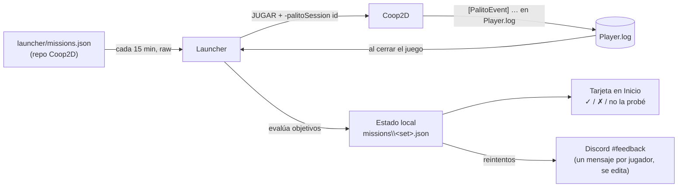

# Misiones de prueba (launcher 1.0.6)

> Referencia del sistema en el launcher. Lo que tiene que hacer el juego (los eventos en su log) está en
> [EVENTOS-JUEGO.md](EVENTOS-JUEGO.md); un ejemplo listo para copiar, en [missions.example.json](missions.example.json); los
> pasos para publicarlo, en [TAREAS-MANUALES.md](TAREAS-MANUALES.md#12-misiones-de-prueba-launchermissionsjson).
> Índice de toda la documentación: [docs/README.md](README.md).

Las **misiones de prueba** son retos cortos para los testers durante un playtest («Provoca un Vapor en dúo», «Únete a
una partida ya empezada»). Sustituyen a pedirles que lean la lista de pruebas: el launcher les dice qué probar,
**detecta solo** lo que consiguen leyendo los eventos que el juego escribe en su log, les deja marcar lo que falló y
manda los resultados a Discord.

Las encuestas cortas de cada build (`feedback.json`) siguen igual. Las misiones son una pieza aparte.

## Contenido

1. [Cómo funciona](#1-cómo-funciona)
2. [launcher/missions.json](#2-launchermissionsjson)
3. [Objetivos: cómo se describe una misión](#3-objetivos-cómo-se-describe-una-misión)
4. [Lectura del log y reglas de conteo](#4-lectura-del-log-y-reglas-de-conteo)
5. [Estado guardado en el PC](#5-estado-guardado-en-el-pc)
6. [Interfaz](#6-interfaz)
7. [Envío a Discord](#7-envío-a-discord)
8. [Ejemplos de misiones (a partir de la lista de pruebas)](#8-ejemplos-de-misiones-a-partir-de-la-lista-de-pruebas)
9. [Piezas de código y tests](#9-piezas-de-código-y-tests)
10. [Cómo probarlo](#10-cómo-probarlo)
11. [Decisiones tomadas y escalabilidad](#11-decisiones-tomadas-y-escalabilidad)

## 1. Cómo funciona



1. Publicas un **conjunto de misiones** en `launcher/missions.json` del repo Coop2D (por PR, como `feedback.json`).
2. El launcher lo lee y muestra la tarjeta **Misiones de prueba** en Inicio.
3. Al pulsar JUGAR, añade `-palitoSession <id>` a los argumentos del juego.
4. El juego escribe eventos en su `Player.log` mientras se juega ([EVENTOS-JUEGO.md](EVENTOS-JUEGO.md)).
5. Al cerrarse el juego, el launcher lee esos eventos, comprueba qué objetivos se cumplieron y actualiza el progreso.
6. El jugador ve ✓ en lo conseguido y puede marcar **Falló** (con una nota) o **No la probé** en lo demás.
7. El launcher manda o actualiza un mensaje en Discord con los resultados de ese jugador.

El juego no sabe nada de misiones: solo cuenta hechos. Mientras una misión use eventos que la build ya emite, puedes
crearla o cambiarla **sin sacar otra build**.

## 2. launcher/missions.json

Mismo patrón que `feedback.json` y `launcher.json`:

- Remoto: `https://raw.githubusercontent.com/JJJP-Dev/Coop2D/main/launcher/missions.json` (`LauncherConfig.RemoteMissionsUrl`),
  con caché y ETag, sin gastar cupo de la API. Se relee cada 15 min.
- Local para pruebas: `%LOCALAPPDATA%\PalitoLauncher\missions.local.json`, con prioridad sobre el remoto.
- Si no existe, no hay tarjeta. Si está roto, se usa la última copia buena.
- JSON con comentarios y comas finales; los campos con un tipo incorrecto se ignoran uno a uno; máximo 256 KB.

```json
{
  "id": "pre2-sesion-1",                       // obligatorio; cámbialo para empezar de cero
  "title": "Misiones del Pre 2",
  "intro": "Prueba esto en la sesión del sábado. Lo que consigas se marca solo.",
  "minGameVersion": "0.0.4-prototype.2",       // sesiones con una versión anterior no cuentan
  "startsUtc": "2026-10-31T19:00:00+01:00",    // opcional: desde cuándo se muestra
  "endsUtc":   "2026-11-07T23:59:00+01:00",    // opcional: después se cierra y se envía lo que haya
  // "discordWebhookUrl": "…",                // opcional: por defecto, el webhook de feedback.json
  "missions": [
    {
      "id": "duo-vapor",
      "title": "Provoca un Vapor en dúo",
      "hint": "Uno marca con fuego (básico o clic derecho) y el otro detona con agua (clic izquierdo).",
      "goal": { "event": "reaction", "where": { "variant": "vapor_*", "duo": true, "me": ["aura", "detonator"] } },
      "check": "¿Se vio el titular «VAPOR!» y la nube?"
    },
    {
      "id": "numeros",
      "title": "Fíjate en los números de daño",
      "hint": "¿Se leen bien en medio de una oleada?",
      "manual": true
    }
  ]
}
```

### Campos del conjunto

| Campo | Tipo | Obligatorio | Detalles |
|---|---|---|---|
| `id` | id | sí | Letras, números, `-`, `_`, `.` (máx. 64). Un id nuevo = progreso de cero para todos |
| `title` | texto | no | Máx. 80. Por defecto «Misiones de prueba» |
| `intro` | texto | no | Máx. 300 |
| `minGameVersion` | versión | no | Mismo formato que `requiredVersion` de launcher.json. Si falta, cuenta cualquier versión que emita eventos |
| `startsUtc` / `endsUtc` | fecha | no | Con zona horaria. Fuera de la ventana no se muestra; al pasar `endsUtc` se envían los resultados finales |
| `discordWebhookUrl` | webhook | no | Canal para los resultados. Si falta, se usa el webhook de `feedback.json` (no el de los reportes de fallos); si tampoco hay, esperan en la bandeja |
| `missions` | lista | sí | De 1 a **12** misiones (más no caben en una tarjeta ni en un mensaje de Discord) |

### Campos de cada misión

| Campo | Tipo | Obligatorio | Detalles |
|---|---|---|---|
| `id` | id | sí | Único dentro del conjunto |
| `title` | texto | sí | Máx. 60. En imperativo: «Únete a una partida ya empezada» |
| `hint` | texto | no | Máx. 200. Cómo conseguirlo |
| `goal` | objeto | sí, salvo `manual` | Ver [sección 3](#3-objetivos-cómo-se-describe-una-misión) |
| `manual` | bool | no | `true` = no se detecta sola; el jugador marca Funcionó / Falló / No la probé |
| `check` | texto | no | Máx. 120. Pregunta de comprobación tras completarla (Sí / No + nota): «¿Se vio el titular?» |
| `allowCheats` | bool | no | Por defecto `false`: no cuenta lo conseguido en una partida con trucos |
| `allowSolo` | bool | no | Por defecto `true`. Con `false`, solo cuentan partidas con al menos 2 jugadores |

## 3. Objetivos: cómo se describe una misión

Un objetivo es una **regla sobre los eventos** del log. Deliberadamente simple: si una misión no se puede escribir
así, probablemente necesita un evento nuevo en el juego, no una regla más complicada.

```json
{ "event": "enemy_killed", "where": { "by": "me", "source": "reaction" }, "count": 5, "scope": "set" }
```

| Campo | Detalles |
|---|---|
| `event` | Nombre del evento (`ev`). Obligatorio |
| `where` | Condiciones sobre sus campos (todas tienen que cumplirse). Opcional |
| `count` | Cuántos eventos que cumplan `where` hacen falta. Por defecto 1 |
| `sum` | En vez de contar eventos, suma ese campo numérico (p. ej. `"sum": "targets"`) y lo compara con `count` |
| `scope` | `match` (todo en la misma partida), `session` (en la misma ejecución del juego, **por defecto**) o `set` (acumulado entre sesiones mientras dure el conjunto) |
| `all` | En lugar de lo anterior, una lista de objetivos que tienen que cumplirse **todos** (cada uno con su `scope`). Máx. 6. Sin anidar |
| `any` | Igual, pero basta con **uno** de la lista |

Condiciones de `where`:

| Forma | Significa | Ejemplo |
|---|---|---|
| `"campo": "valor"` | Igual (sin distinguir mayúsculas) | `"role": "client"` |
| `"campo": "prefijo*"` | Empieza por | `"variant": "vapor_*"` |
| `"campo": ["a", "b"]` | Cualquiera de la lista | `"target": ["public", "vpn"]` |
| `"campo": true` | Booleano | `"late": true` |
| `"campo": 3` | Número igual | `"slot": 1` |
| `"campo": { ">=": 3 }` | Comparación: `>=`, `>`, `<=`, `<` (números) y `!=` (números o texto) | `"players": { ">=": 4 }`, `"me": { "!=": "none" }` |

Un campo que no viene en el evento no cumple ninguna condición (así una build antigua sin ese campo no da falsos
positivos). Un objetivo mal escrito (sin `event`, operador desconocido, `count` que no es un número, `all` dentro de
`all`…) convierte **solo esa misión** en manual y se apunta en el log. Un nombre de evento que no está en el contrato
v1 **sí** se acepta (así se pueden usar eventos nuevos del juego sin actualizar el launcher), pero se avisa en el log por
si es una errata.

## 4. Lectura del log y reglas de conteo

**Cuándo se lee:**

- Al cerrarse el juego que siguió el launcher (`GameProcessManager.GameExited`), con unos segundos de espera para que
  Unity termine de escribir.
- Al arrancar el launcher, `Player.log` y `Player-prev.log` si contienen una sesión que aún no se procesó (por si el
  launcher estaba cerrado mientras se jugaba). Solo cuentan si su `session_start.utc` cae dentro de la ventana del
  conjunto.

**Cómo se lee:**

- Con `FileShare.ReadWrite | FileShare.Delete`, por líneas, hasta **64 MB** (lo que pase de ahí se ignora y se apunta).
- Solo las líneas que encajan con las expresiones de [EVENTOS-JUEGO.md, sección 2](EVENTOS-JUEGO.md#2-formato-de-una-línea).
  Lo demás del log (Unity, trazas, `[Perf]`) se ignora.
- Un log puede tener varias sesiones si el juego se abrió varias veces sin launcher; cada `session_start` abre una
  nueva.

**Qué sesiones cuentan:**

- Tiene que haber `session_start` con `v=1`. Sin él, el log no es de una build con eventos y no se mira.
- Solo cuentan las sesiones que **arrancaron dentro de la ventana** del conjunto: desde `startsUtc` (o, si no hay, desde
  que este launcher vio el conjunto por primera vez, con 10 minutos de margen) hasta `endsUtc`. Da igual que el juego
  se abriera desde el launcher (`launcher_session=<id>`) o por su cuenta (`none`).
- Cada sesión se procesa **una sola vez** (se guarda su `launcher_session`, o `utc` + `game_version` si es `none`).
  Una sesión sin `utc` solo cuenta si el conjunto no tiene ventana.
- `game_version` menor que `minGameVersion` → no cuenta, y la tarjeta lo explica («Actualiza el juego para que cuenten
  tus misiones»).
- Las **instancias extra** del modo desarrollador se abren con su propio `-logFile` y no cuentan.

**Partidas y trucos:**

- Una partida va de `match_joined` a `match_left` (o al final de la sesión). Los eventos de fuera de una partida (menú:
  `join_attempt`, `join_result`, `host_started`…) cuentan como un grupo aparte, nunca «con trucos».
- Desde el primer `cheat_used` de una partida, todo lo que ocurre en ella está **con trucos**. Las misiones sin
  `allowCheats` no cuentan esos eventos.
- `allowSolo: false` exige que en esa partida hubiera `players >= 2` en algún momento (los eventos de fuera de una
  partida no se ven afectados).

**Resultado de cada misión automática:** completada (con fecha, versión y si fue con trucos) o pendiente. Lo que se
apunta como «falló» lo decide siempre el jugador. Si hubo `log_error` en la misma partida, se adjunta como pista en
los resultados («2 errores en esa partida»), pero no cambia el estado.

## 5. Estado guardado en el PC

`%LOCALAPPDATA%\PalitoLauncher\missions\<id del conjunto>.json`, con escritura atómica (como `settings.json`):

```json
{
  "setId": "pre2-sesion-1",
  "createdUtc": "2026-10-31T18:55:00+00:00",
  "reporterId": "9f8e7d",
  "missions": {
    "duo-vapor": { "state": "done", "parts": [ { "done": true, "progress": 0 } ], "completedUtc": "2026-10-31T20:14:03+00:00",
                   "gameVersion": "0.0.4-prototype.2", "automatic": true, "withCheats": false, "checkAnswer": false,
                   "note": "El titular salió detrás de la nube", "errorsNearby": 0 },
    "numeros":   { "state": "failed", "parts": [], "note": "Con 30 enemigos se pisan y no se leen" }
  },
  "processedSessions": ["9f2c4e7a1b3d4c5e8f9a0b1c2d3e4f50"],
  "sessionsCounted": 1,
  "sessionsTooOld": 0,
  "discordMessageId": "1234567890",
  "discordWebhookKey": "discord.com/123456789012345678",
  "dirty": false,
  "finalSent": false
}
```

- `state`: `pending`, `done`, `failed` o `skipped` (no la probé). Una completada sola no se puede deshacer; si se vio
  mal, el jugador lo dice con la pregunta de `check` («No…» + nota). Una misión marcada como fallida o no probada que
  luego se consigue pasa a `done` (y conserva la nota).
- `parts`: un elemento por objetivo (varios con `all`/`any`); `progress` es lo acumulado en los de `scope: "set"`.
- `reporterId`: aleatorio, distingue a los jugadores anónimos en Discord. `discordWebhookKey`: el webhook (sin token)
  del mensaje guardado; si cambia el webhook, se publica un mensaje nuevo.
- Si se publica otra versión del conjunto con el **mismo id**, se conserva el progreso de las misiones con el mismo id
  y las nuevas empiezan en `pending`.
- Se guardan como mucho los 10 conjuntos más recientes.

## 6. Interfaz

**Tarjeta en Inicio** (debajo de la de la sesión de prueba), solo si hay un conjunto activo y el ajuste está
activado:

- Título, `intro`, «3 de 6 completadas» y una barra de progreso.
- Lista de misiones: icono de estado (✓ verde, ✗ rojo, — no probada, ○ pendiente), título, estado («Completada · 31 oct
  21:14», «Progreso: 12 / 30», «Se marca sola al conseguirla», «Márcala tú al terminar de probarla») y `hint` en gris
  mientras no está completada.
- Enlaces por misión: **Funcionó** (solo manuales), **Falló…** (abre una nota de máx. 300 caracteres), **No la
  probé** y **Deshacer** (de lo marcado a mano).
- Las completadas solas con `check` muestran la pregunta con **Sí** / **No…** (nota).
- Si la versión instalada es menor que `minGameVersion`, aviso ámbar «actualiza el juego para que cuenten».
- Abajo: «Enviar resultados ahora».

**Al cerrar el juego:** si se completaron misiones nuevas, toast «✓ Misión completada: …» o «✓ 2 misiones completadas:
…». Nunca abre un diálogo: la invitación a la encuesta sigue siendo la única pregunta al cerrar el juego.

**Ajustes › Juego:** «Mostrar las misiones de prueba» (activado por defecto; todos los jugadores son testers, pero nada
es obligatorio) y, si hay resultados sin enviar, el aviso con **Enviar ahora**. El nombre se toma de «Tu nombre en
Discord (opcional)», el mismo de las opiniones y los reportes.

**Informe para el desarrollador:** id del conjunto, estado de cada misión, sesiones procesadas y último envío.

## 7. Envío a Discord

- **Un mensaje por jugador y conjunto**, que se va **editando**: el primer envío es `POST {webhook}?wait=true` (que
  devuelve el id del mensaje) y los siguientes, `PATCH {webhook}/messages/{id}`. Si el mensaje ya no existe (404), se
  crea otro. Así el canal no se llena con un mensaje por partida.
- **Cuándo:** tras procesar una sesión con cambios, 20 s después de la última marca del jugador, en la comprobación
  periódica si quedó algo pendiente, con **Enviar ahora** y al pasar `endsUtc` (envío final, con «Final» en el título).
  Como mucho un envío automático cada 2 minutos por jugador. No se envía nada hasta que hay algo que contar (una
  sesión con eventos o una marca).
- **Bandeja:** el estado local es la fuente; el envío solo baja el indicador `dirty` cuando Discord confirma. Mismas
  reglas que `FeedbackService`: 429 respeta `retry_after`, 5xx/red reintenta en la comprobación periódica, 400 deja de
  intentarlo y lo apunta.
- **Webhook:** `discordWebhookUrl` del conjunto o, si falta, el de `feedback.json` (canal `#feedback`). Sin ninguno, los
  resultados esperan en el PC y Ajustes dice que se enviarán cuando el equipo active los envíos.
- **Embed:** título «🧪 Misiones del Pre 2 · <nombre>» (el de «Tu nombre en Discord»; si no hay, «Jugador anónimo
  #9f8e»); descripción «**3 de 6** completadas · 1 con fallos · 1 sin probar» y las sesiones registradas; un campo por
  estado (✅ conseguidas con la hora en formato de Discord, ❌ fallaron con su nota, ⏳ pendientes con su progreso, ➖ no
  las probó); pistas («con trucos», «se vio mal», «⚠ 2 errores en esa partida»); footer «Launcher 1.0.6 · Coop2D 0.0.4 ·
  Prototipo 2 · <conjunto> · id <reporterId>»; color verde si están todas, rojo si alguna falló y azul en curso. Los
  textos se escapan (sin negritas ni enlaces falsos) y las menciones están desactivadas.
- Sin adjuntos: si una misión falla de verdad, el jugador tiene **Reportar un problema**, que ya manda los logs.

## 8. Ejemplos de misiones (a partir de la lista de pruebas)

| Prueba de la lista | Misión | Objetivo |
|---|---|---|
| 2. Hospedar | «Hospeda una partida» | `{ "event": "match_joined", "where": { "role": "host" } }` |
| 13. Internet | «Únete a alguien de fuera de tu casa» | `{ "event": "join_result", "where": { "result": "ok", "target": ["public", "vpn"] } }` |
| 4. Entrar tarde | «Únete a una partida ya empezada» | `{ "event": "match_joined", "where": { "late": true } }` |
| 3. Entrar y salir | «Sal y vuelve a entrar tres veces» | `{ "event": "match_joined", "where": { "role": "client" }, "count": 3 }` |
| 4. Puntos de aparición | «Juega una partida de cuatro» | `any` con `{ "event": "match_joined", "where": { "players": { ">=": 4 } } }` y `{ "event": "player_joined", "where": { "players": { ">=": 4 } } }` (entras el cuarto, o entra alguien y ya sois cuatro) |
| 7. Oleadas | «Llega al final de las oleadas» | `{ "event": "waves_finished", "scope": "match" }` |
| 10. Reacción | «Provoca un Vapor en dúo» + `check` «¿Se vio el titular?» | `{ "event": "reaction", "where": { "variant": "vapor_*", "duo": true, "me": ["aura", "detonator"] } }` |
| 10. Las seis variantes | «Participa en las tres reacciones» | `all` con tres objetivos `reaction`, uno por `variant` (`vapor_*`, `electrocution_*`, `overload_*`), cada uno con `"me": { "!=": "none" }` y `scope: "set"` |
| 11. Varias a la vez | «Detona una reacción sobre 3 enemigos a la vez» | `{ "event": "reaction", "where": { "me": ["detonator", "both"], "targets": { ">=": 3 } } }` |
| 7. Combate | «Elimina 30 perseguidores» | `{ "event": "enemy_killed", "where": { "by": "me", "enemy": "chaser" }, "count": 30, "scope": "set" }` |
| 11. Textos | «¿Se leen los números de daño?» | `"manual": true` |
| 5. Sin temblor | «¿Se ve tu personaje estable al moverte?» | `"manual": true` |

**Buenas prácticas:** entre 4 y 8 misiones por sesión; una o dos fáciles para empezar («Hospeda una partida»); como
mucho 2 manuales; `check` solo en las visuales; y un `id` de conjunto nuevo en cada playtest.

## 9. Piezas de código y tests

Siguiendo la estructura del proyecto ([ARQUITECTURA.md](ARQUITECTURA.md)):

| Pieza | Dónde | Qué hace |
|---|---|---|
| `GameEvent`, `GameSession`, `GameEventParser` | [`Core/Missions/GameEvents.cs`](../src/PalitoLauncher.Core/Missions/GameEvents.cs) | Lee un log y devuelve sesiones con sus eventos (puro salvo `ParseFile`, que nunca lanza) |
| `MissionSet`, `Mission`, `MissionGoal`, `MissionSetState`… | [`Core/Missions/MissionModels.cs`](../src/PalitoLauncher.Core/Missions/MissionModels.cs) | Modelo de `missions.json` y del estado en disco |
| `MissionsProvider` | [`Core/Missions/MissionsProvider.cs`](../src/PalitoLauncher.Core/Missions/MissionsProvider.cs) | Descarga, caché, `missions.local.json` y saneado (calcado de `ManifestProvider`) |
| `MissionEvaluator` | [`Core/Missions/MissionEvaluator.cs`](../src/PalitoLauncher.Core/Missions/MissionEvaluator.cs) | Aplica sesiones a un estado: ventana, versión, partidas, trucos, `scope`, `where`, `count`/`sum`, `all`/`any`. Puro y determinista |
| `MissionStateStore` | [`Core/Missions/MissionStateStore.cs`](../src/PalitoLauncher.Core/Missions/MissionStateStore.cs) | Lee y escribe `missions\<set>.json` de forma atómica; aparta los dañados |
| `MissionReportService` | [`Core/Missions/MissionReportService.cs`](../src/PalitoLauncher.Core/Missions/MissionReportService.cs) | Embed y POST/PATCH al webhook |
| `MainViewModel.Missions.cs` | [`PalitoLauncher/ViewModels/`](../src/PalitoLauncher/ViewModels/MainViewModel.Missions.cs) | Al arrancar, cada 15 min y tras `GameExited`: lee, evalúa, guarda, toast y envía; marcas del jugador; `-palitoSession` y `-logFile` |
| `MissionsCardViewModel`, `MissionItemViewModel` | [`PalitoLauncher/ViewModels/MissionsCardViewModel.cs`](../src/PalitoLauncher/ViewModels/MissionsCardViewModel.cs) | Tarjeta y cada misión (estado, enlaces, nota) |
| `MissionsCard.xaml` | [`PalitoLauncher/Views/`](../src/PalitoLauncher/Views/MissionsCard.xaml) | Tarjeta de Inicio |

Tests: `GameEventParserTests`, `MissionsProviderTests`, `MissionEvaluatorTests` y `MissionReportServiceTests` (Core) y
`MissionsUiTests` + `BindingSmokeTests` (interfaz).

## 10. Cómo probarlo

**Sin el juego** (antes de que Coop2D emita eventos):

1. Guarda [missions.example.json](missions.example.json) como `%LOCALAPPDATA%\PalitoLauncher\missions.local.json` y abre
   el launcher: aparece la tarjeta en Inicio.
2. Escribe a mano un `Player.log` de prueba en la carpeta de datos del juego
   (`%USERPROFILE%\AppData\LocalLow\PalitoGames\Coop2D\Player.log`) con líneas como las del
   [ejemplo de EVENTOS-JUEGO.md](EVENTOS-JUEGO.md#8-ejemplo-de-una-sesión), con un `utc` de ahora, y reinicia el
   launcher: las misiones que cumplan se marcan solas.
3. En el log del launcher, busca `Misiones:` (qué conjunto, qué sesiones contaron, qué se completó y el resultado del
   envío). El **informe para el desarrollador** incluye «Misiones de prueba».
4. Borra `missions.local.json`, el `Player.log` de prueba y `%LOCALAPPDATA%\PalitoLauncher\missions\` para empezar de
   cero.

**Con el juego:** juega una partida corta desde el launcher, ciérralo y en unos segundos aparece el toast con lo que se
completó.

## 11. Decisiones tomadas y escalabilidad

- **Canal:** los resultados van al webhook de `feedback.json` (`#feedback`); `discordWebhookUrl` permite separarlos si
  algún día hace falta.
- **Quién las ve:** todos los jugadores (todos son testers), nada obligatorio; se pueden ocultar en Ajustes.
- **Identidad:** el nombre de las opiniones, que ahora se llama «Tu nombre en Discord (opcional)» en Ajustes, la encuesta
  y los reportes, para que coincida con el del servidor.

**¿Escala?** Sí, para lo que es (un grupo de testers):

- **Trabajo en cada PC:** cada launcher lee solo su propio log (unos pocos MB, una vez al cerrar el juego) y evalúa como
  mucho 12 misiones. No depende de cuántos jugadores haya.
- **Contenido:** misiones nuevas sin compilar nada mientras usen eventos existentes; eventos nuevos sin tocar el
  launcher (los nombres desconocidos se aceptan). El contrato está versionado (`v=1`).
- **Discord:** un mensaje por jugador y conjunto que se edita, como mucho un envío cada 2 minutos por jugador. Con 20-30
  testers son unas pocas peticiones por minuto, muy por debajo de los límites de un webhook. El límite real es
  **leerlo**: con muchos jugadores, un canal lleno de mensajes no sirve para sacar conclusiones.
- **Cuándo deja de escalar:** si el grupo pasa de unas decenas de testers o se quieren estadísticas (porcentajes por
  misión, comparar builds), Discord ya no es el sitio: el siguiente paso sería un pequeño servicio que reciba los mismos
  datos (el estado JSON de cada jugador ya tiene todo) y los agregue. Con Steam, el mismo modelo «eventos → reglas» encaja
  con sus estadísticas y logros.
