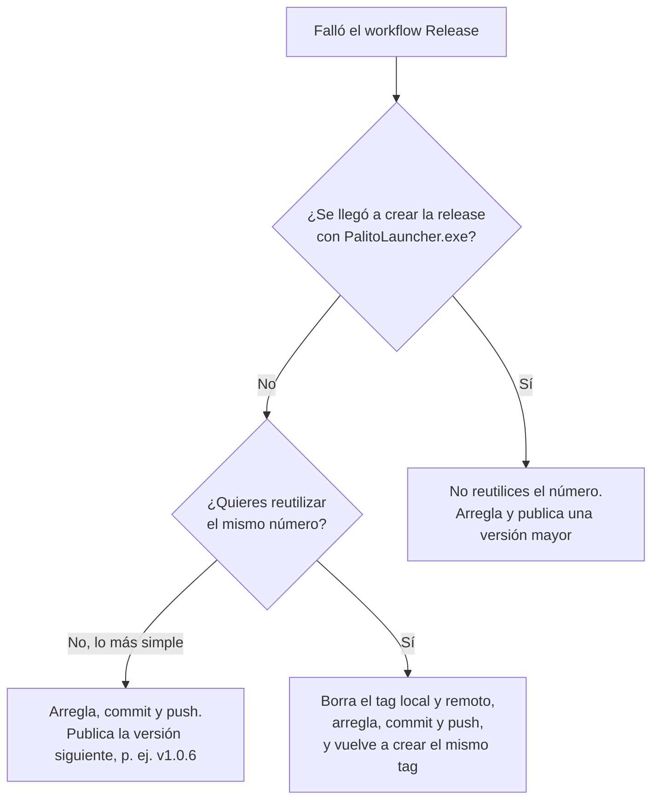

# Tareas manuales: lo que solo puedes hacer tú

El launcher hace solo casi todo (instalar, actualizar, reintentar, enviar opiniones…), pero hay cosas que necesitan tus
cuentas de Discord y GitHub y que ningún programa (ni una IA) puede hacer por ti. Esta es la lista, con pasos numerados.
Marca las casillas a medida que las hagas.

> Índice de toda la documentación: [docs/README.md](README.md). Detalle de las opiniones: [FEEDBACK.md](FEEDBACK.md).
> Publicar builds del juego: [PUBLICAR.md](PUBLICAR.md). Roadmap: [ROADMAP.md](ROADMAP.md).

## Resumen

**Una vez (ahora):**

- [ ] [1. Discord: canales #feedback y #bugs con sus webhooks](#1-discord-canales-y-webhooks)
- [ ] [2. Publicar launcher/feedback.json](#2-publicar-launcherfeedbackjson)
- [ ] [3. Publicar launcher/launcher.json](#3-publicar-launcherlauncherjson) (tiene efecto a partir del launcher 1.0.5)
- [ ] [4. Fondo del launcher: launcher/background.png](#4-fondo-del-launcher-launcherbackgroundpng) (opcional)

**Cada vez que toque:**

- [5. Publicar una build del juego](#5-publicar-una-build-del-juego)
- [6. Publicar una versión del launcher](#6-publicar-una-versión-del-launcher)
- [7. Antes y después de cada sesión de playtest](#7-antes-y-después-de-cada-sesión-de-playtest)

**Si algo falla y de vez en cuando:**

- [8. Si GitHub Actions falla](#8-si-github-actions-falla)
- [9. Renovar o rotar un webhook](#9-renovar-o-rotar-un-webhook)
- [10. Mantenimiento de vez en cuando](#10-mantenimiento-de-vez-en-cuando)
- [11. Cuando el grupo crezca](#11-cuando-el-grupo-crezca)
- [Referencia rápida](#referencia-rápida)

Los archivos de configuración remota (`feedback.json`, `launcher.json`, `background.png`) van en la carpeta
**`launcher/`** de la raíz del repo **JJJP-Dev/Coop2D**, rama `main`. Como `main` está protegida, se suben siempre con
una **pull request** (PR). **Por qué en el repo del juego:** así cambias encuesta, avisos o fondo de todos los launchers
en minutos, sin compilar ni publicar el launcher, y se descargan desde `raw.githubusercontent.com`, que no gasta el cupo
de 60 consultas por hora de la API de GitHub.

## 1. Discord: canales y webhooks

Objetivo: dos canales privados, `#feedback` (opiniones de la encuesta) y `#bugs` (reportes de problemas, launcher
1.0.5), cada uno con su webhook. **Por qué dos canales:** las opiniones («¿fue divertido?») y los fallos («se cierra al
entrar en la sala») se leen y se gestionan distinto; separados, los bugs no se pierden entre valoraciones.

- [ ] 1. Si no tenéis servidor: en Discord, **+** (Añadir un servidor) → **Crear el mío** → **Para mí y mis amigos** →
      nombre → **Crear**.
- [ ] 2. Crea el canal **`feedback`**: **+** junto a «CANALES DE TEXTO» → tipo **Texto** → nombre `feedback` → activa
      **Canal privado** → **Siguiente** → **Crear canal**.
- [ ] 3. Crea el canal **`bugs`** igual.
- [ ] 4. Webhook de `#feedback`: rueda dentada del canal (**Editar canal**) → **Integraciones** → **Webhooks** →
      **Nuevo webhook** → púlsalo → (opcional) nombre e imagen → **Copiar URL de webhook** → **Guardar cambios**.
      Detalle y comprobación con PowerShell: [FEEDBACK.md, paso 2](FEEDBACK.md#paso-2-crear-el-webhook).
- [ ] 5. Webhook de `#bugs`: lo mismo en el canal `#bugs`.
- [ ] 6. Apunta en una nota privada qué URL es de qué canal (la de `#feedback` irá en `feedback.json` y la de `#bugs` en
      `launcher.json`).
- [ ] 7. Avisos: clic derecho en cada canal → **Ajustes de notificaciones** → **Todos los mensajes**. Los mensajes del
      launcher no mencionan a nadie, así que sin esto Discord no te avisará.
- [ ] 8. Enlace de invitación permanente (para el botón de Discord del launcher): clic derecho en el servidor →
      **Invitar gente** → **Editar enlace de invitación** → «Caducar después de: **Nunca**», «Número máximo de usos:
      **Sin límite**» → **Generar un nuevo enlace** → copia el enlace `https://discord.gg/…`.

**Seguridad:** las URLs de los webhooks acabarán en archivos públicos del repo. Con ellas solo se puede publicar en
**ese** canal (y gestionar el propio webhook), no leer el servidor. Si alguien abusa: [punto 9](#9-renovar-o-rotar-un-webhook).

## 2. Publicar launcher/feedback.json

Sin este archivo, el launcher usa una encuesta por defecto y guarda las respuestas en cada PC hasta que haya webhook.

- [ ] 1. Copia [`docs/feedback.example.json`](feedback.example.json) como `feedback.json` y pon la URL del webhook de
      `#feedback` en `discordWebhookUrl`. Ajusta preguntas e `id` si quieres ([FEEDBACK.md](FEEDBACK.md#cambiar-las-preguntas)).
- [ ] 2. Pruébalo en tu PC: cópialo a `%LOCALAPPDATA%\PalitoLauncher\feedback.local.json`, reinicia el launcher, envía
      una opinión con **Enviar opinión** y comprueba que llega a `#feedback`.
- [ ] 3. Publícalo: GitHub → repo Coop2D → **Add file → Create new file** → nombre `launcher/feedback.json` → pega el
      contenido → **Commit changes…** → **Create a new branch for this commit and start a pull request** →
      **Propose changes** → **Create pull request** → **Merge pull request → Confirm merge** → **Delete branch**.
- [ ] 4. Borra tu `feedback.local.json` y reinicia el launcher: en el log (`%LOCALAPPDATA%\PalitoLauncher\logs`) debe
      salir `Encuesta de feedback: «…» (N preguntas, webhook: discord.com/api/webhooks/…/***)`.

Guía completa, con un ejemplo de lo que sale en Discord y problemas típicos: [FEEDBACK.md](FEEDBACK.md#guía-paso-a-paso-que-las-opiniones-lleguen-a-tu-discord).

## 3. Publicar launcher/launcher.json

`launcher/launcher.json` es el «tablón» del launcher a partir de la **1.0.5**: anuncios arriba del contenido, builds
con problemas graves, enlaces de comunidad (Discord, itch…), sesiones de prueba con cuenta atrás y aviso 15 min antes,
datos para hostear partida y el webhook de **Reportar un problema**. Hoy no existe en el repo y todo funciona sin él;
los launchers 1.0.4 o anteriores simplemente no lo leen.

> **Plantilla provisional.** La referencia completa y definitiva de cada campo está en
> [LAUNCHER-JSON.md](LAUNCHER-JSON.md). Si algo de aquí no coincide con ella, manda LAUNCHER-JSON.md.

Plantilla mínima (anuncio de bienvenida + enlace de Discord + una sesión de ejemplo + webhook de `#bugs`):

```json
{
  "announcements": [
    {
      "id": "bienvenida-1",
      "level": "info",
      "title": "¡Bienvenido al playtest de Coop2D!",
      "message": "Gracias por probar el juego. Si algo falla, usa «Reportar un problema» en el menú ⋯.",
      "url": "https://discord.gg/TU_INVITACION",
      "linkText": "Unirme al Discord",
      "dismissible": true
    }
  ],
  "links": [
    { "label": "Discord", "url": "https://discord.gg/TU_INVITACION", "icon": "discord" }
  ],
  "playtests": [
    {
      "id": "pre2-sesion-1",
      "title": "Prueba de diversión del Pre 2",
      "description": "Probamos las reacciones entre elementos. Entrad al canal de voz 5 minutos antes.",
      "startsUtc": "2026-10-31T21:00:00+01:00",
      "durationMinutes": 120,
      "requiredVersion": "2D_0.0.3_Prototype2.zip",
      "discordUrl": "https://discord.gg/TU_INVITACION"
    }
  ],
  "bugReportWebhookUrl": "https://discord.com/api/webhooks/PEGA_AQUI_LA_URL_DEL_WEBHOOK_DE_BUGS"
}
```

Qué cambiar antes de publicarla:

- `https://discord.gg/TU_INVITACION` → tu invitación permanente ([punto 1](#1-discord-canales-y-webhooks), paso 8).
- `bugReportWebhookUrl` → la URL del webhook de `#bugs`. Si la dejas así (no es válida) o la quitas, los reportes usan
  el webhook de `feedback.json`.
- `playtests`: fecha y hora **con zona horaria**. En España: `+01:00` en invierno y `+02:00` en verano (el cambio es el
  último domingo de marzo y de octubre). Las sesiones ya pasadas no se muestran, así que puedes dejarlas o borrarlas.
- `requiredVersion`: el nombre exacto del archivo de la build que hay que tener (el de la release de GitHub), su tag
  (`v0.0.3`) o su versión (`0.0.3-prototype.2`). Si no hace falta una versión concreta, quita la línea.
- `id` de anuncios y sesiones: únicos, con letras, números, `-`, `_` o `.`. Sirven para recordar quién cerró un anuncio
  y a quién ya se avisó de una sesión: **cambia el `id`** si quieres que un anuncio vuelva a salir a todos.

Pasos:

- [ ] 1. Cuando tengas el launcher 1.0.5 instalado, guarda tu archivo como `%LOCALAPPDATA%\PalitoLauncher\launcher.local.json`
      (tiene prioridad sobre el publicado, solo en tu PC) y reinicia el launcher para ver cómo queda.
- [ ] 2. Comprueba que es JSON válido:
      `Get-Content "$env:LOCALAPPDATA\PalitoLauncher\launcher.local.json" -Raw -Encoding UTF8 | ConvertFrom-Json | Out-Null`
      (sin salida = correcto).
- [ ] 3. Publícalo como `launcher/launcher.json` en Coop2D con una PR, igual que `feedback.json`
      ([punto 2](#2-publicar-launcherfeedbackjson), paso 3).
- [ ] 4. Borra `launcher.local.json` y reinicia el launcher para comprobar que ve el publicado.

Los launchers lo vuelven a leer cada 15 minutos mientras están abiertos (`LauncherConfig.ManifestRefreshInterval`), sin
gastar cupo de la API de GitHub.

## 4. Fondo del launcher: launcher/background.png

Opcional. Si existe, el launcher lo usa como fondo (si no, un degradado).

- [ ] 1. Prepara una imagen **PNG o JPG** de **1920×1080**, idealmente de **menos de 2 MB** (máximo 20 MB). Se recorta
      para llenar la ventana y se oscurece con un degradado: deja lo importante en el centro.
- [ ] 2. Llámala exactamente **`background.png`** (aunque sea un JPG).
- [ ] 3. GitHub → repo Coop2D → carpeta `launcher/` → **Add file → Upload files** → arrastra la imagen → **Commit
      changes** con **Create a new branch… and start a pull request** → crea y fusiona la PR.
- [ ] 4. Cierra y abre el launcher: el fondo se descarga al arrancar (con caché; no gasta cupo de la API).

Para quitarlo, borra el archivo con otra PR: los launchers vuelven al fondo por defecto.

## 5. Publicar una build del juego

Guía completa: [PUBLICAR.md](PUBLICAR.md). Resumen:

- [ ] 1. Unity → *Player Settings → Version* (p. ej. `0.0.4-prototype.2`) y build de Windows x64 con el exe
      **`Coop2D.exe`**.
- [ ] 2. Comprime la carpeta como `2D_0.0.N_PrototypeP.zip` (pre-producción) o `2D_X.Y.Z.zip` (producción), con un número
      **mayor** que el anterior.
- [ ] 3. GitHub → Coop2D → **Releases → Draft a new release** → tag `v0.0.N` → título y notas → adjunta el zip (uno
      solo) → espera a que suba → **Publish release** («Set as a pre-release» solo para el canal de pruebas).
- [ ] 4. En tu launcher: **Versiones → Actualizar lista** para comprobar que aparece.
- [ ] 5. Si hay una sesión de prueba en `launcher.json` que la necesita, actualiza su `requiredVersion`.
- [ ] 6. Si una build publicada tiene un fallo grave, no la borres: publica una corrección con número mayor (y, desde la
      1.0.5, márcala en `blockedBuilds` de `launcher.json` para avisar a quien la tenga; ver [LAUNCHER-JSON.md](LAUNCHER-JSON.md)).

## 6. Publicar una versión del launcher

El launcher se publica en **JJJP-Dev/PalitoLauncher** con GitHub Actions
([release.yml](../.github/workflows/release.yml)): al subir un tag `vX.Y.Z`, el workflow compila, ejecuta los tests y
crea la release con **`PalitoLauncher.exe`**. Los launchers instalados la detectan solos.

- [ ] 1. Comprueba que la CI de `main` está en verde: GitHub → PalitoLauncher → **Actions → CI**.
- [ ] 2. Sube la versión en [`Directory.Build.props`](../Directory.Build.props) (`<Version>1.0.5</Version>`), haz commit
      (p. ej. «Launcher 1.0.5: …») y `git push`. **Por qué:** el tag manda en la release, pero así las compilaciones
      locales llevan la misma versión.
- [ ] 3. Crea y sube el tag: `git tag v1.0.5` y después `git push origin v1.0.5` (desde la carpeta del repo
      PalitoLauncher, en la rama `main` ya actualizada).
- [ ] 4. GitHub → **Actions → Release**: espera a que termine en verde (5-10 min). Si falla: [punto 8](#8-si-github-actions-falla).
- [ ] 5. GitHub → **Releases → v1.0.5**: comprueba que tiene el asset **`PalitoLauncher.exe`** (con ese nombre exacto:
      es lo que busca la auto-actualización). Si quieres, edita las notas (se generan solas con los commits).
- [ ] 6. En tu launcher: **Ajustes → Buscar ahora** → aviso «Nueva versión del launcher…» → **Actualizar**. Se
      reinicia solo con la versión nueva.
- [ ] 7. Tus amigos no tienen que hacer nada: su launcher lo comprueba al abrirse y cada hora (como mucho una vez cada
      2 h) y les muestra el aviso.

**Probar antes una versión de prueba:** un tag con sufijo (`v1.0.5-beta.1`) se publica como **pre-release** y no llega a
nadie automáticamente. Para probarla, cierra tu launcher, descarga el exe de esa release y ábrelo con `--portable` para
que no se copie encima del instalado:

```powershell
& "$env:USERPROFILE\Downloads\PalitoLauncher.exe" --portable
```

(usa los mismos ajustes y la misma instalación del juego que tu launcher normal).

**Si una versión sale mal:** si la versión nueva no llega a arrancar en un PC, el launcher vuelve solo a la anterior
(«La nueva versión del launcher no pudo iniciarse; se restauró la anterior.») y no vuelve a ofrecer esa versión. Arregla
el fallo y publica una versión **mayor** (nunca vuelvas a usar un número ya publicado: los launchers que ya lo tienen no
recibirían el arreglo). Mientras tanto puedes editar la release mala y marcar **Set as a pre-release**, para que deje de
ser la «última» y nadie más la descargue.

## 7. Antes y después de cada sesión de playtest

**Antes (el día anterior o unas horas antes):**

- [ ] La build está publicada en el canal normal, probada en tu PC y sus notas dicen qué versión necesitan todos.
- [ ] `launcher/feedback.json`: preguntas pensadas para lo que quieres averiguar en esta sesión y `id` nuevo si
      cambiaron ([FEEDBACK.md](FEEDBACK.md#buenas-prácticas-para-encuestas-de-playtest)).
- [ ] `launcher/launcher.json` (1.0.5): la sesión en `playtests` con fecha, hora con zona, `requiredVersion` y enlace de
      Discord; si quieres, un anuncio.
- [ ] Probado todo en local (`feedback.local.json` / `launcher.local.json`), publicado por PR y **borrados los archivos
      locales**.
- [ ] Una opinión de prueba llega a `#feedback` (y, con la 1.0.5, un reporte de prueba a `#bugs`).
- [ ] Recuerda a todos que abran el launcher antes de la sesión para que se actualicen (la descarga puede tardar).

**Después:**

- [ ] Lee `#feedback` y `#bugs`. Convierte cada fallo en una issue de Coop2D asignada al milestone que toque (así sale en
      el [roadmap](ROADMAP.md)).
- [ ] Cierra las issues terminadas y, si el objetivo del milestone está cumplido, cierra el milestone.
- [ ] Cuenta en las notas de la siguiente release qué cambiaste gracias a las opiniones.
- [ ] Quita (o deja caducar con `endsUtc`) los anuncios que ya no sirvan.

## 8. Si GitHub Actions falla

Hay dos workflows en el repo PalitoLauncher:

| Workflow | Cuándo se ejecuta | Qué hace |
|---|---|---|
| **CI** ([ci.yml](../.github/workflows/ci.yml)) | Cada push y pull request a `main` | Compila y ejecuta los tests |
| **Release** ([release.yml](../.github/workflows/release.yml)) | Al subir un tag `v*` (o a mano: **Actions → Release → Run workflow**) | Compila, prueba, publica el exe y crea la release |

**Paso a paso:**

- [ ] 1. GitHub → PalitoLauncher → **Actions** → pulsa la ejecución con la ✗ roja → pulsa el job → despliega el paso
      que falló (los pasos tienen nombres en español).
- [ ] 2. Busca el paso en esta tabla:

| Paso que falla | Causa típica | Qué hacer |
|---|---|---|
| Instalar .NET 10 / Restaurar paquetes | Fallo de red puntual de GitHub o NuGet | **Re-run jobs** (arriba a la derecha) |
| Calcular la versión | El tag no tiene la forma `v1.2.3` (o `v1.2.3-beta.1`) | Borra el tag y créalo bien (ver abajo) |
| Compilar | El código no compila | Reprodúcelo en tu PC: `dotnet build PalitoLauncher.sln -c Release` |
| Tests | Un test falla | En tu PC: `dotnet test PalitoLauncher.sln -c Release`. El log del paso dice qué test falló y por qué; en el workflow CI además puedes descargar el artefacto `test-results` (al final de la página de la ejecución) y abrir el `.trx` con Visual Studio. Si falla una vez y al repetir pasa, era un test inestable: anótalo |
| Comprobar PalitoLauncher.exe | La versión del exe no coincide con el tag, hay DLL sueltas o cambió el nombre del ensamblado | Revisa los cambios del `.csproj` de la UI y `Directory.Build.props` |
| Crear la release en GitHub (error 403) | El workflow no tiene permiso para crear releases | **Settings → Actions → General → Workflow permissions → Read and write permissions** → **Save** y **Re-run jobs** |

- [ ] 3. Si el fallo era puntual o de permisos: **Re-run jobs** (repite la misma ejecución con el mismo commit).
- [ ] 4. Si hay que cambiar código y era una **Release**, el tag apunta al commit roto. Elige:



Borrar un tag (solo si **no** se creó la release) y volver a crearlo:

```powershell
git tag -d v1.0.5                    # borra el tag en tu PC
git push origin :refs/tags/v1.0.5    # borra el tag en GitHub
# ... arregla, git commit, git push ...
git tag v1.0.5
git push origin v1.0.5
```

Si la CI falla en una **pull request**, no la fusiones hasta que esté en verde: lo que entra en `main` es lo que luego
se publica.

## 9. Renovar o rotar un webhook

**Cuándo:** si alguien publica spam en `#feedback` o `#bugs`, si la URL se ha visto en una captura o chat público, si
alguien con permisos deja el equipo, o al cambiar de canal.

**Urgente (spam):**

- [ ] 1. Discord → canal → **Editar canal → Integraciones → Webhooks** → abre el webhook → **Eliminar webhook**. El spam
      se corta al momento.
- [ ] 2. Crea uno nuevo ([punto 1](#1-discord-canales-y-webhooks), paso 4 o 5) y copia la URL.
- [ ] 3. Cambia la URL en `launcher/feedback.json` (`discordWebhookUrl`) o en `launcher/launcher.json`
      (`bugReportWebhookUrl`) con una PR.

**Planificado (sin prisa):** crea primero el webhook nuevo, publica el JSON con la URL nueva, espera un día (a que los
launchers lo recojan) y después borra el viejo.

En ambos casos **no hace falta publicar el launcher** y no se pierde nada: lo que se envíe al webhook borrado recibe un
404, se queda en la bandeja de salida de cada PC y se reenvía solo cuando su launcher lee el JSON nuevo (al abrirse, en
la comprobación de cada hora, o con **Ajustes → Juego → Reintentar envío**).

## 10. Mantenimiento de vez en cuando

- [ ] **Milestones al día** en GitHub: cierra los terminados y revisa las fechas límite ([ROADMAP.md](ROADMAP.md)).
- [ ] **`launcher.json` limpio**: quita anuncios caducados y sesiones pasadas (no molestan, pero el archivo se lee
      mejor).
- [ ] **Webhooks vivos**: en Discord, **Integraciones → Webhooks** de cada canal; si borraste alguno, actualiza el JSON.
- [ ] **Versión del launcher**: `<Version>` de `Directory.Build.props` igual que el último tag publicado.
- [ ] **Documentación**: si cambias cómo funciona algo, actualiza el documento de `docs/` correspondiente en el mismo
      commit. Es lo que te permitirá retomar el proyecto meses después sin depender de nadie.
- [ ] **Tests**: `dotnet test PalitoLauncher.sln` antes de cada versión (la CI lo hace igualmente).

## 11. Cuando el grupo crezca

Hoy sois 4-5. Cuando el juego merezca grupos más grandes:

- [ ] **Discord**: roles (p. ej. «Testers») y permisos por canal; un hilo por sesión de playtest en `#feedback` usando
      `?thread_id=` en el webhook ([FEEDBACK.md](FEEDBACK.md#paso-2-crear-el-webhook)).
- [ ] **Encuestas**: más preguntas cerradas y los mismos Ids entre versiones para poder comparar
      ([FEEDBACK.md](FEEDBACK.md#buenas-prácticas-para-encuestas-de-playtest)).
- [ ] **Límite de GitHub**: el cupo de 60 consultas/hora se comparte por IP. En una LAN party con muchos PCs detrás del
      mismo router, el launcher sigue funcionando con su caché, pero «Buscar actualizaciones» puede decir que hay que
      esperar. Publica la build **antes** de la sesión, no durante.
- [ ] **Canal de pruebas**: usa las pre-releases del juego para probar builds con unos pocos antes de dárselas a todos
      ([PUBLICAR.md](PUBLICAR.md#3-canales-normal-y-de-pruebas)).
- [ ] **SmartScreen**: con más gente, el aviso «Windows protegió su PC» frena a los que no te conocen. Solo se quita
      firmando el exe con un certificado de firma de código (de pago). Es una decisión tuya.
- [ ] **Steam**: a partir de la 0.5 (CBT 1) las ramas de Steam sustituyen al launcher para la gente de fuera
      ([PUBLICAR.md](PUBLICAR.md#1-esquema-de-versiones-del-proyecto)); el launcher sigue siendo la herramienta del equipo.

## Referencia rápida

| Qué | Dónde |
|---|---|
| Encuesta de opiniones | `launcher/feedback.json` en Coop2D (`main`) → <https://raw.githubusercontent.com/JJJP-Dev/Coop2D/main/launcher/feedback.json> |
| Tablón del launcher (1.0.5) | `launcher/launcher.json` en Coop2D (`main`) |
| Fondo | `launcher/background.png` en Coop2D (`main`) |
| Pruebas locales (solo tu PC) | `%LOCALAPPDATA%\PalitoLauncher\feedback.local.json` y `launcher.local.json` |
| Logs del launcher | `%LOCALAPPDATA%\PalitoLauncher\logs\launcher-AAAAMMDD.log` |
| Bandejas de salida (cada PC) | `%LOCALAPPDATA%\PalitoLauncher\feedback\outbox\` y, desde la 1.0.5, `%LOCALAPPDATA%\PalitoLauncher\reports\outbox\` |
| Releases del juego | <https://github.com/JJJP-Dev/Coop2D/releases> |
| Milestones (roadmap) | <https://github.com/JJJP-Dev/Coop2D/milestones> |
| Releases del launcher | <https://github.com/JJJP-Dev/PalitoLauncher/releases> |
| Workflows del launcher | <https://github.com/JJJP-Dev/PalitoLauncher/actions> |
| Versión del launcher | [`Directory.Build.props`](../Directory.Build.props) |
| Repos, URLs e intervalos | [`LauncherConfig.cs`](../src/PalitoLauncher.Core/LauncherConfig.cs) |
