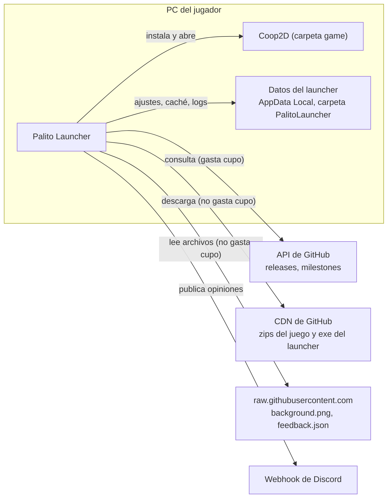
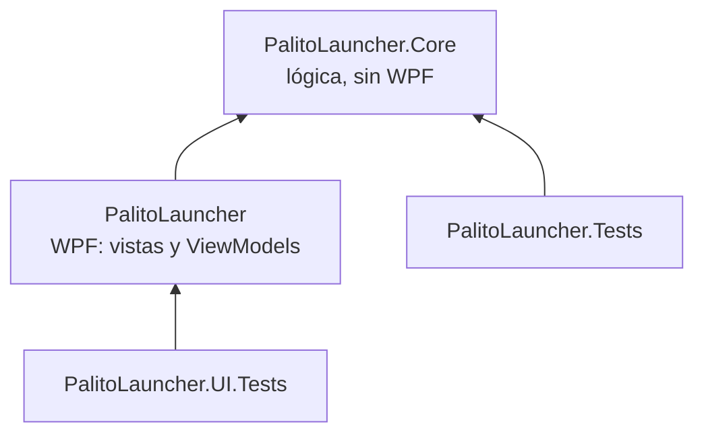
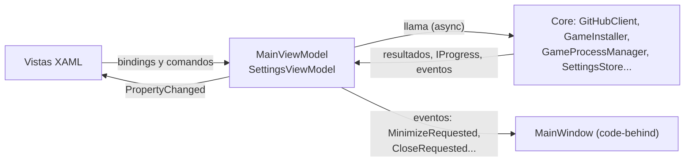
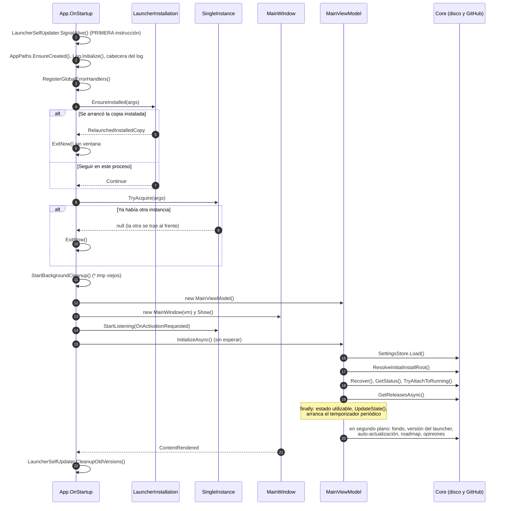
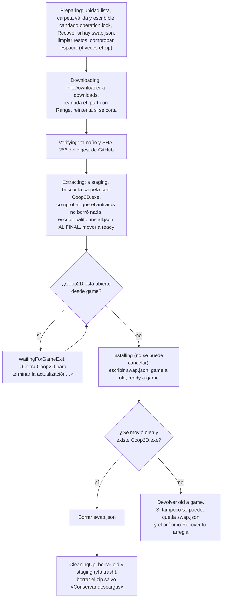
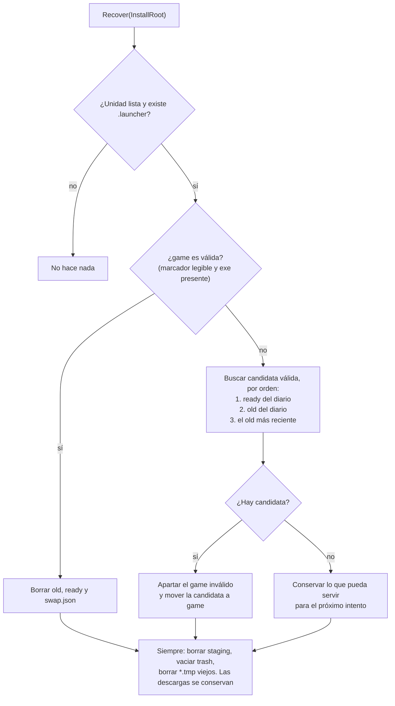
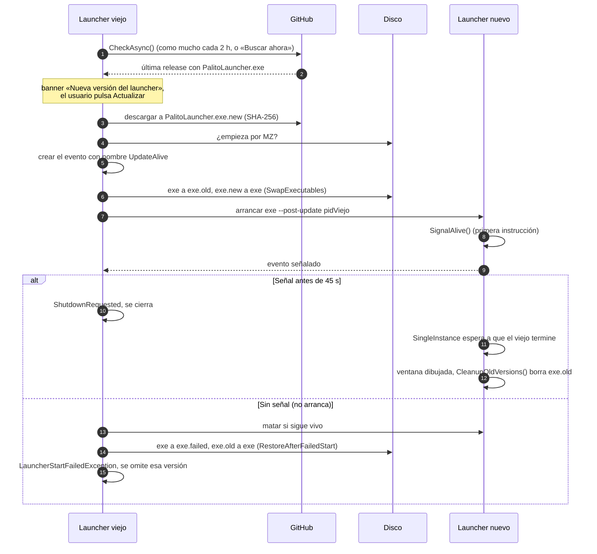
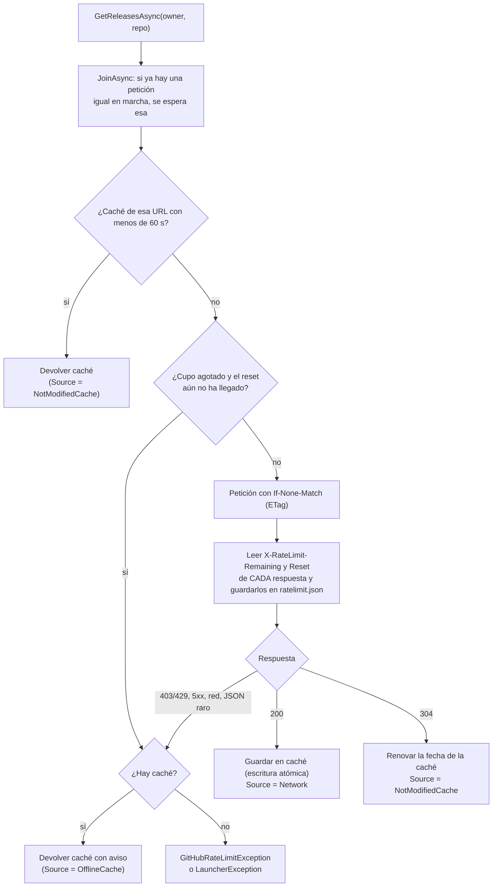
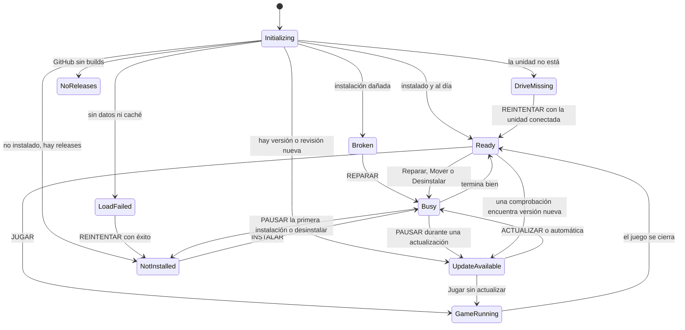

# Arquitectura de Palito Launcher

Este documento explica **cómo está montado el launcher y por qué**. No hace falta leerlo de una vez: úsalo como mapa
cuando quieras tocar algo y no recuerdes dónde vive o qué puede romperse.

- Describe el código tal y como salió en la **versión 1.0.4**. Lo que añade la 1.0.5 (`launcher/launcher.json`,
  reportes de problemas, herramientas de desarrollo) se documenta aparte en [LAUNCHER-JSON.md](../remoto/LAUNCHER-JSON.md).
- Para aprender a leer y modificar el código paso a paso, ve a [GUIA-CODIGO.md](GUIA-CODIGO.md).
- El índice de toda la documentación está en [README.md](../README.md).

## Índice

1. [Visión general](#1-visión-general)
2. [Capas y proyectos](#2-capas-y-proyectos)
3. [Mapa de carpetas](#3-mapa-de-carpetas)
4. [Quién es dueño de qué en tiempo de ejecución](#4-quién-es-dueño-de-qué-en-tiempo-de-ejecución)
5. [Arranque](#5-arranque)
6. [Instalar y actualizar el juego](#6-instalar-y-actualizar-el-juego)
7. [Auto-instalación y auto-actualización del launcher](#7-auto-instalación-y-auto-actualización-del-launcher)
8. [GitHub: caché y límite de consultas](#8-github-caché-y-límite-de-consultas)
9. [Qué se guarda en disco y dónde](#9-qué-se-guarda-en-disco-y-dónde)
10. [Máquina de estados del botón principal](#10-máquina-de-estados-del-botón-principal)
11. [Errores y avisos](#11-errores-y-avisos)
12. [Decisiones de diseño y alternativas descartadas](#12-decisiones-de-diseño-y-alternativas-descartadas)
13. [Reglas que no hay que romper](#13-reglas-que-no-hay-que-romper)

---

## 1. Visión general

Palito Launcher es una aplicación de escritorio de Windows (C# / .NET 10 / WPF) que:

- consulta las **releases de GitHub** del repo del juego (`JJJP-Dev/Coop2D`) y elige la build jugable de cada una;
- **instala, actualiza, repara, mueve y desinstala** Coop2D sin que el usuario descomprima nada;
- **abre el juego** y sabe si está en marcha;
- **se instala y se actualiza a sí mismo** desde las releases de su propio repo (`JJJP-Dev/PalitoLauncher`);
- muestra el **roadmap** (milestones de GitHub) y recoge **opiniones** que publica en Discord.



### Las reglas de oro

Casi todas las decisiones del código salen de estas seis ideas. Si dudas al cambiar algo, comprueba que no rompes
ninguna:

1. **Nunca dejar el juego roto.** La versión nueva se prepara aparte y se intercambia con la vieja al final, con un
   «diario» que permite deshacer el cambio aunque se vaya la luz a mitad.
2. **Nunca bloquear la ventana.** Todo lo lento (red, disco, hash) va en segundo plano (`async`/`await`, `Task.Run`).
3. **Mensajes para amigos, no para programadores.** Los errores esperables son `LauncherException` con un texto en
   español listo para enseñar; todo lo demás va al log y el usuario ve un mensaje genérico con «Crear informe».
4. **Gastar lo mínimo de GitHub.** Sin token, la API permite 60 consultas por hora **por IP** y las respuestas 304
   también cuentan. Varios amigos en la misma casa comparten ese cupo.
5. **Funcionar sin conexión.** Si el juego está instalado se puede jugar aunque GitHub no responda.
6. **Registrarlo todo.** Cualquier fallo queda en el log, y el «informe para el desarrollador» empaqueta lo necesario.

---

## 2. Capas y proyectos

La solución [`PalitoLauncher.sln`](../../PalitoLauncher.sln) tiene cuatro proyectos:

| Proyecto | Tipo | Depende de | Contiene |
|---|---|---|---|
| [`src/PalitoLauncher.Core`](../../src/PalitoLauncher.Core/PalitoLauncher.Core.csproj) | Biblioteca (sin WPF) | SharpCompress (solo .rar/.7z) | Toda la lógica: GitHub, versiones, descargas, instalación, proceso del juego, auto-actualización, ajustes, logs, roadmap, encuesta |
| [`src/PalitoLauncher`](../../src/PalitoLauncher/PalitoLauncher.csproj) | Aplicación WPF (`WinExe`) | Core | Ventana, vistas XAML, ViewModels, tema, diálogos |
| [`tests/PalitoLauncher.Tests`](../../tests/PalitoLauncher.Tests/PalitoLauncher.Tests.csproj) | Tests xUnit | Core | Tests de la lógica (sin red, sin ventanas) |
| [`tests/PalitoLauncher.UI.Tests`](../../tests/PalitoLauncher.UI.Tests/PalitoLauncher.UI.Tests.csproj) | Tests xUnit (WPF) | UI (y Core) | Tests de ViewModels, MarkdownRenderer y errores de binding de todas las vistas |



Las flechas van en un solo sentido: **el Core no sabe que existe una ventana**. Las propiedades comunes (versión,
`Nullable`, `LangVersion`…) están en [`Directory.Build.props`](../../Directory.Build.props).

### Por qué separar Core y UI

- **Se puede probar sin ventana.** Los tests del Core se ejecutan en milisegundos, sin hilo de UI ni pantalla. Toda la
  lógica difícil (comparar versiones, decidir el estado, reanudar descargas, intercambiar carpetas) está ahí.
- **Cada capa tiene un idioma.** El Core habla de releases, archivos y procesos; la UI habla de botones, textos y
  colores. Así un cambio visual no puede romper la instalación, y viceversa.
- **Lógica pura aparte.** Las decisiones sin E/S están en clases estáticas puras
  ([`LauncherStateLogic`](../../src/PalitoLauncher.Core/State/LauncherStateLogic.cs),
  [`ReleaseSelector`](../../src/PalitoLauncher.Core/GitHub/ReleaseSelector.cs),
  [`GameVersion`](../../src/PalitoLauncher.Core/Versioning/GameVersion.cs),
  [`RoadmapLogic`](../../src/PalitoLauncher.Core/State/RoadmapLogic.cs)): reciben datos y devuelven una respuesta. Son las
  más fáciles de leer y de probar.

### Convenciones del Core

- Nada de WPF. `ConfigureAwait(false)` en los `await` (el Core no necesita volver a ningún hilo concreto).
- Errores esperables → [`LauncherException`](../../src/PalitoLauncher.Core/Util/LauncherException.cs) con mensaje en
  español. Los métodos que nunca deben fallar lo dicen en su documentación («Nunca lanza») y capturan todo.
- La documentación XML (`/// <summary>`) de cada método **es su especificación**: describe qué hace en cada caso.
  Antes de cambiar un método, léela; si cambias el comportamiento, actualízala.
- Lo que los tests necesitan sustituir (reloj, tiempos de espera, funciones de disco) es `internal` y se expone a los
  tests con `InternalsVisibleTo` en el `.csproj`.

---

## 3. Mapa de carpetas

### Core ([`src/PalitoLauncher.Core`](../../src/PalitoLauncher.Core))

| Carpeta / archivo | Responsabilidad | Clases principales |
|---|---|---|
| [`LauncherConfig.cs`](../../src/PalitoLauncher.Core/LauncherConfig.cs) | Configuración fija: repos, nombre del exe del juego, patrones de assets, URLs, intervalos | `LauncherConfig` |
| [`AppPaths.cs`](../../src/PalitoLauncher.Core/AppPaths.cs) | Rutas de datos (`%LOCALAPPDATA%\PalitoLauncher`, carpeta de instalación por defecto…) | `AppPaths` |
| [`GitHub/`](../../src/PalitoLauncher.Core/GitHub) | Cliente de la API con caché, ETag, límite de consultas y modo sin conexión; modelos; selección de builds | `GitHubClient`, `ReleaseSelector`, `ReleaseInfo`, `ReleaseAsset`, `GameRelease`, `MilestoneInfo` |
| [`Versioning/`](../../src/PalitoLauncher.Core/Versioning) | Versión a partir del nombre del asset / tag / título, y su orden | `GameVersion` |
| [`Downloads/`](../../src/PalitoLauncher.Core/Downloads) | Descarga reanudable con reintentos y verificación SHA-256 | `FileDownloader`, `DownloadRequest`, `DownloadProgress` |
| [`Install/`](../../src/PalitoLauncher.Core/Install) | Instalar/actualizar/reparar/mover/desinstalar con intercambio seguro; extracción de .zip/.rar/.7z; marcador de versión | `GameInstaller`, `ArchiveExtractor`, `InstalledGameInfo`, `InstallStatus`, `InstallProgress` |
| [`Launch/`](../../src/PalitoLauncher.Core/Launch) | Lanzar el juego y seguir su proceso | `GameProcessManager` |
| [`Update/`](../../src/PalitoLauncher.Core/Update) | Auto-instalación del exe y auto-actualización del launcher | `LauncherInstallation`, `LauncherSelfUpdater` |
| [`State/`](../../src/PalitoLauncher.Core/State) | Lógica pura de decisión: estado del botón principal y roadmap | `LauncherStateLogic`, `RoadmapLogic` |
| [`Feedback/`](../../src/PalitoLauncher.Core/Feedback) | Encuesta (remota / local / por defecto) y envío a Discord con bandeja de salida | `SurveyProvider`, `FeedbackService`, `SurveyDefinition` |
| [`Settings/`](../../src/PalitoLauncher.Core/Settings) | Ajustes del usuario en `settings.json` | `LauncherSettings`, `SettingsStore` |
| [`Logging/`](../../src/PalitoLauncher.Core/Logging) | Log de archivo que nunca lanza | `Log` |
| [`Diagnostics/`](../../src/PalitoLauncher.Core/Diagnostics) | Zip «informe para el desarrollador» y resumen del entorno | `DiagnosticReport` |
| [`Net/`](../../src/PalitoLauncher.Core/Net) | `HttpClient` compartido con el User-Agent que exige GitHub | `HttpFactory` |
| [`Util/`](../../src/PalitoLauncher.Core/Util) | Sistema de archivos (escritura atómica, mover con reintentos, validar carpetas), accesos directos, excepción de usuario | `FileSystemUtil`, `ShortcutUtil`, `LauncherException` |

### UI ([`src/PalitoLauncher`](../../src/PalitoLauncher))

| Carpeta / archivo | Responsabilidad |
|---|---|
| [`App.xaml.cs`](../../src/PalitoLauncher/App.xaml.cs) | Arranque, instancia única, manejadores globales de errores, vuelta atrás si una actualización no abre |
| [`MainWindow.xaml`](../../src/PalitoLauncher/MainWindow.xaml) / [`.cs`](../../src/PalitoLauncher/MainWindow.xaml.cs) | Ventana sin borde (`WindowChrome`): barra de título, navegación, páginas, barra de acción, overlay de diálogos. El code-behind solo tiene lógica de vista (tamaño, teclado, confirmación al cerrar) |
| [`ViewModels/`](../../src/PalitoLauncher/ViewModels) | Estado y comandos. `MainViewModel` está partido en cinco archivos: [`MainViewModel.cs`](../../src/PalitoLauncher/ViewModels/MainViewModel.cs) (estado y presentación), [`.Startup.cs`](../../src/PalitoLauncher/ViewModels/MainViewModel.Startup.cs) (arranque, consultas, eventos del juego), [`.Operations.cs`](../../src/PalitoLauncher/ViewModels/MainViewModel.Operations.cs) (acciones del usuario y operaciones largas), [`.Roadmap.cs`](../../src/PalitoLauncher/ViewModels/MainViewModel.Roadmap.cs) y [`.Feedback.cs`](../../src/PalitoLauncher/ViewModels/MainViewModel.Feedback.cs) |
| [`Views/`](../../src/PalitoLauncher/Views) | Páginas (`HomeView`, `VersionsView`, `RoadmapView`, `SettingsView`) y diálogos (`MessageDialogView`, `InstallDialogView`, `SurveyDialogView`); control propio `StarRating` |
| [`Services/`](../../src/PalitoLauncher/Services) | `DialogService` (diálogos dentro de la ventana), `SingleInstance`, `ShellService` (abrir carpetas/URLs), `NativeMethods` (parpadeo de la barra de tareas) |
| [`Helpers/`](../../src/PalitoLauncher/Helpers) | `MarkdownRenderer` (notas → `FlowDocument`), `UiFormat` (bytes, fechas…), `AppInfo`, `LiveRegion`, `ScrollHelper`, `UiAssist` |
| [`Converters/`](../../src/PalitoLauncher/Converters) | Conversores de binding (bool → visibilidad, null → visibilidad, negación) |
| [`Themes/Theme.xaml`](../../src/PalitoLauncher/Themes/Theme.xaml) | Paleta, fuentes, conversores y estilos de todos los controles |
| [`Assets/`](../../src/PalitoLauncher/Assets) | Logo e icono (se regeneran con [`scripts/generate-icons.ps1`](../../scripts/generate-icons.ps1)) |

### Resto del repo

| Ruta | Qué es |
|---|---|
| [`tests/PalitoLauncher.Tests/`](../../tests/PalitoLauncher.Tests) | Un archivo de tests por clase del Core (`GameInstallerTests.cs`, `GitHubClientTests.cs`…) y ayudantes en `TestHelpers/` |
| [`tests/PalitoLauncher.UI.Tests/`](../../tests/PalitoLauncher.UI.Tests) | Tests de la UI; el hilo de WPF compartido está en `TestHelpers/WpfHost.cs` |
| [`.github/workflows/ci.yml`](../../.github/workflows/ci.yml) | Compila y pasa los tests en cada push / pull request a `main` |
| [`.github/workflows/release.yml`](../../.github/workflows/release.yml) | Publica una versión del launcher al subir un tag `v*` |
| [`scripts/publish.ps1`](../../scripts/publish.ps1) | Publica el exe en local (lo mismo que el workflow) |
| [`docs/`](..) | Esta documentación |

---

## 4. Quién es dueño de qué en tiempo de ejecución

El [`MainViewModel`](../../src/PalitoLauncher/ViewModels/MainViewModel.cs) es el **único dueño** de las instancias del
Core. No hay contenedor de inyección de dependencias: se crean en su constructor y viven lo que vive la ventana.

```csharp
// Instancias del Core (este ViewModel es su único dueño).
var http = HttpFactory.Shared;
_github = new GitHubClient(http, AppPaths.CacheDir);
var downloader = new FileDownloader(http);
_installer = new GameInstaller(downloader, LauncherConfig.GameExecutableName);
_process = new GameProcessManager();
_settingsStore = new SettingsStore(AppPaths.SettingsFile);
_selfUpdater = new LauncherSelfUpdater(_github, new FileDownloader(http), AppPaths.CacheDir);
```

(Extracto del constructor de `MainViewModel`; justo después crea también `SurveyProvider` y `FeedbackService`.)

Cómo fluye la información:



Dos piezas clave del `MainViewModel`:

- **`UpdateState()`** es la única función que «pinta». Recalcula el estado con `LauncherStateLogic.ComputeState` y, a
  partir de él, el texto y el icono del botón principal, el texto de estado, la barra de progreso, el aviso secundario,
  los chips de Inicio y el progreso de la barra de tareas. Es barata y se llama tras cualquier cambio (incluso con cada
  tick de progreso). Regla práctica: **cambia el estado (campos `_xxx`) y llama a `UpdateState()`**; no toques las
  propiedades de presentación desde fuera.
- **Una sola operación larga a la vez.** `StartOperation` pone `IsBusy = true`, crea un `CancellationTokenSource` y
  ejecuta la operación; `RunOperationCoreAsync` limpia, vuelve a mirar el disco y muestra el error si lo hubo. Si hay
  otra en marcha, la nueva no empieza («Espera a que termine la operación en curso.»).

Todo el estado del `MainViewModel` se toca **solo desde el hilo de UI**. Lo que llega de otros hilos (eventos del
proceso del juego, peticiones de otra instancia) se pasa al hilo de UI con `Dispatcher.BeginInvoke`.

---

## 5. Arranque

Archivos: [`App.xaml.cs`](../../src/PalitoLauncher/App.xaml.cs) (`OnStartup`) y
[`MainViewModel.Startup.cs`](../../src/PalitoLauncher/ViewModels/MainViewModel.Startup.cs) (`InitializeAsync`).



Por qué este orden:

1. **`SignalAlive()` va lo primero** porque, si este arranque viene de una auto-actualización, la versión vieja está
   esperando esa señal (máx. 45 s) para saber que la nueva arranca. Si se retrasara por algo lento, la vieja creería
   que la nueva no funciona y la desharía (ver [sección 7](#7-auto-instalación-y-auto-actualización-del-launcher)).
2. **El log antes que nada más**, para que cualquier fallo posterior quede registrado. La cabecera incluye
   `DiagnosticReport.GetEnvironmentSummary()` (versión, Windows, .NET, ruta del exe…).
3. **Los manejadores globales de errores enseguida** (en el código están antes de la auto-instalación aunque los
   comentarios numerados digan «5»), para cubrir el resto del arranque.
4. **La auto-instalación antes que la instancia única**: si el exe se abrió desde Descargas, se copia a
   `%LOCALAPPDATA%\Programs\PalitoLauncher` y se abre esa copia; este proceso se cierra sin ventana y sin haber tomado
   el mutex, así la copia lo puede tomar.
5. **Instancia única** (`Local\PalitoLauncher.SingleInstance`): si ya hay un launcher abierto, se le pide que se muestre
   y este proceso se cierra. Si la otra instancia no responde, se ofrece cerrarla. Con `--post-update <pid>` espera a
   que la versión vieja termine.
6. **La ventana se muestra antes de consultar nada**, y luego `InitializeAsync()` hace el trabajo. Está envuelto en
   `try/finally`: pase lo que pase, la pantalla **nunca se queda en «CARGANDO…»**.
7. **JUGAR se habilita como muy tarde a los 5 s** (`OpenPlayGateLaterAsync`) aunque GitHub no haya respondido: con el
   juego instalado nunca se impide jugar por culpa de la red.
8. **Los restos de la auto-actualización (`<exe>.old`…) se borran cuando la ventana ya se ha dibujado**
   (`OnMainWindowRendered`). Hasta ese momento, `<exe>.old` es la copia para volver atrás si la versión nueva no abre.

Al cerrar: `MainWindow.OnClosing` pregunta a `MainViewModel.GetCloseDecision()` (`Allow`, `Confirm`, `MustWait` o
`ConfirmUnsentFeedback`). Si Windows cierra la sesión (`App.OnSessionEnding`), no se pregunta nada: se cancela la
operación (la descarga queda en pausa) y se guardan los ajustes.

---

## 6. Instalar y actualizar el juego

Archivos: [`GameInstaller.cs`](../../src/PalitoLauncher.Core/Install/GameInstaller.cs),
[`FileDownloader.cs`](../../src/PalitoLauncher.Core/Downloads/FileDownloader.cs),
[`ArchiveExtractor.cs`](../../src/PalitoLauncher.Core/Install/ArchiveExtractor.cs). Desde la UI se llega por
`MainViewModel.InstallBodyAsync` (en `MainViewModel.Operations.cs`).

### Estructura en disco de una instalación

`InstallRoot` es la carpeta que eligió el usuario (por defecto `%LOCALAPPDATA%\PalitoGames\Coop2D`):

```text
InstallRoot\
  game\                      ← versión actual (Coop2D.exe + palito_install.json)
  .launcher\                 ← carpeta oculta de trabajo
    downloads\<assetId>-<nombre>   ← descargas (+ .part y .part.json mientras se descargan)
    staging\<8 hex>\         ← extracción temporal
    ready\                   ← versión nueva verificada, a punto de entrar
    old\<yyyyMMddHHmmss>\    ← versión anterior durante el intercambio
    trash\<8 hex>\           ← carpetas pendientes de borrar
    swap.json                ← diario del intercambio
    operation.lock           ← candado entre procesos
  game.backup-<fecha>\       ← (solo si game\ tenía archivos que no eran del launcher)
```

El archivo **`game\palito_install.json`** (clase `InstalledGameInfo`) es la **fuente de verdad** de qué versión hay
instalada: tag, ids de release y asset, SHA-256, versión y nombre del exe. Vive dentro de la carpeta del juego, así que
sobrevive aunque se borren los ajustes del launcher.

### Las fases de `InstallAsync`



Detalles importantes y su porqué:

- **Hasta la fase Installing, `game\` no se toca.** Si algo falla o se cancela antes, el juego viejo sigue intacto. La
  descarga se conserva (completa o parcial) para reintentar sin volver a descargar.
- **El marcador se escribe al final de la extracción** y la carpeta se mueve a `ready\` de una vez: una carpeta con
  marcador válido siempre es una build completa.
- **El intercambio son dos renombrados** (`game` → `old\<fecha>`, `ready` → `game`). Renombrar dentro del mismo disco es
  casi instantáneo y atómico; copiar 180 MB no lo es.
- **`swap.json` es el diario.** Se escribe antes de mover nada. Si el PC se apaga a mitad, al arrancar `Recover`
  encuentra el diario y termina o deshace el cambio.
- **Los borrados pasan por `trash\`.** Una carpeta se renombra primero a `trash\<8 hex>` y luego se borra. Si algo
  queda bloqueado (antivirus), se reintenta en el próximo `Recover`, pero nunca queda un juego «a medio borrar» en
  `game\` u `old\`.
- **Contenido ajeno**: si `game\` tiene archivos que el launcher no reconoce, nunca se borran; se apartan a
  `game.backup-<fecha>`.
- **Candado doble**: dentro del proceso, un `SemaphoreSlim` («Ya hay una operación en curso.»); entre procesos,
  `operation.lock` abierto en exclusiva («Otra ventana del launcher está modificando el juego…»).
- **Espacio**: se pide `GameInstaller.EstimateRequiredBytes` = tamaño del asset × `RequiredSpaceFactor` (4): el zip, lo
  descomprimido (~2,7 veces) y margen. Se comprueba antes de descargar nada.
- **Si la build cambia en GitHub mientras se descarga** (`RemoteAssetChangedException` o
  `DownloadVerificationException`), la UI vuelve a consultar las releases y reintenta una vez con la build nueva si de
  verdad cambió (`InstallBodyAsync` y `FindReplacement` en `MainViewModel.Operations.cs`).

### La descarga reanudable (`FileDownloader`)

- Descarga a `<destino>.part` y guarda metadatos en `<destino>.part.json` (URL original, `ResumeKey` con el id y el
  SHA-256 del asset, validadores de la CDN). Solo reanuda si la clave coincide.
- Cada intento pide la URL **original** (`browser_download_url`) y deja que `HttpClient` siga la redirección: la URL
  firmada de la CDN caduca en ~1 h y nunca se guarda.
- Reanuda con `Range: bytes=N-` y valida la respuesta (206 con el `Content-Range` correcto). Si la CDN dice que el
  archivo cambió, empieza de cero.
- Reintentos con espera creciente (1, 2, 4, 8, 16, 30, 30 s). Solo cuentan los intentos **seguidos sin progreso** (máx.
  8): un intento que avanza 1 MB reinicia la cuenta. Así una conexión mala pero viva nunca «se rinde».
- Si no llegan datos en 30 s (`StallTimeout`), el intento se aborta y se reintenta.
- Al terminar verifica tamaño y SHA-256; si no coincide, borra y repite una vez desde cero.
- **Pausar = cancelar el token**: el `.part` se queda y el botón pasa a «CONTINUAR (45 %)».

### Recuperación al arrancar (`Recover`)

Se llama al arrancar (antes de `GetStatus`) y antes de instalar si hay un `swap.json`:



---

## 7. Auto-instalación y auto-actualización del launcher

### Auto-instalación (`LauncherInstallation.EnsureInstalled`)

El exe descargado actúa como un «instalador portátil». La decisión está separada en una función pura
(`LauncherInstallation.Decide`) para poder probarla:

| Situación | Decisión |
|---|---|
| Argumento `--portable` o `--post-update` | Seguir aquí (`Continue`) |
| Proceso lanzado con `dotnet` | Seguir aquí |
| Ya es la copia instalada (`%LOCALAPPDATA%\Programs\PalitoLauncher\PalitoLauncher.exe`) | Seguir y asegurar el acceso del menú Inicio (`ContinueAsInstalled`) |
| La copia instalada existe y su versión es igual o mayor | Abrir la copia instalada y cerrar este proceso (`LaunchInstalled`) |
| No hay copia instalada o es más vieja | Copiarse allí, crear el acceso «Coop2D» del menú Inicio, abrir la copia y cerrar este proceso (`CopyAndLaunch`) |

Antes de decidir hay dos salidas rápidas: si el proceso es una copia recién relanzada (variable de entorno
`PALITO_LAUNCHER_RELAUNCHED`), nunca se vuelve a relanzar; y si no es el exe publicado (build de desarrollo: hay un
`PalitoLauncher.dll` al lado), no se copia nada.

**Por qué**: así los accesos directos y la auto-actualización usan siempre una ruta estable, sin permisos de
administrador y escribible (en «Archivos de programa» no se podría reemplazar el exe).

### Auto-actualización (`LauncherSelfUpdater`)

Un `.exe` en ejecución **no se puede sobrescribir, pero sí renombrar**. Toda la técnica se apoya en eso:



Y una segunda red de seguridad **en la versión nueva**: si arranca con `--post-update` pero su ventana no llega a
dibujarse (excepción al crearla o error no controlado antes de `ContentRendered`), `App.TryRollbackBrokenUpdate` llama a
`LauncherSelfUpdater.TryRestorePreviousVersion`, guarda la versión rota en `SkippedLauncherVersion`, avisa con un
`MessageBox` y abre la versión anterior.

Otros detalles:

- `CheckAsync` consulta como mucho una vez cada `LauncherConfig.LauncherUpdateCheckInterval` (2 h; marca en
  `cache\launcher-update-check.json`) y nunca si quedan 10 consultas o menos, salvo `force` («Buscar ahora»).
- `LauncherSelfUpdater.CanSelfUpdate` devuelve `false` en desarrollo (`dotnet`, o exe + dll) o si la carpeta no es
  escribible: entonces [Actualizar] abre la página de releases.
- **Solo se omite una versión** (`SkippedLauncherVersion`) si la nueva no llegó a arrancar o si el usuario pulsa
  [Omitir]. Un fallo de red o de descarga deja el banner para reintentar.
- El asset tiene que llamarse **exactamente `PalitoLauncher.exe`** (`LauncherConfig.LauncherAssetPattern`); el workflow
  de release lo comprueba.
- La versión del launcher sale del `AssemblyInformationalVersion` (que viene de `<Version>` en `Directory.Build.props`
  o del tag en el workflow). Se compara con `GameVersion`, la misma clase que las versiones del juego.

---

## 8. GitHub: caché y límite de consultas

Archivo: [`GitHubClient.cs`](../../src/PalitoLauncher.Core/GitHub/GitHubClient.cs). Su `<summary>` de clase resume todas
las reglas; aquí va el porqué.

### El presupuesto

Sin token, GitHub da **60 consultas por hora y por IP**, y las respuestas **304 (sin cambios) también cuentan** (está
comprobado). El ETag ahorra ancho de banda, **no cupo**. No se puede usar un token: iría dentro del exe y sería público.

| Qué | Gasta cupo | Cuándo |
|---|---|---|
| Releases del juego (`GetReleasesAsync`) | Sí, 1 | Al arrancar, cada hora (`PeriodicCheckInterval`), antes de JUGAR si la última consulta tiene más de 10 min (`PrePlayCheckMaxAge`), y con «Buscar actualizaciones» / «Actualizar lista» |
| Milestones del roadmap (`GetMilestonesAsync`) | Sí, 1 | Como mucho 1 cada 10 min (`MilestonesFreshnessWindow`), salvo «Actualizar» en la página |
| Última versión del launcher (`GetLatestReleaseAsync`) | Sí, 1 | Como mucho 1 cada 2 h, salvo «Buscar ahora» |
| Descargar zips y el exe (CDN) | No | — |
| `background.png` y `feedback.json` (raw.githubusercontent.com) | No | El fondo, al arrancar; la encuesta, al arrancar y en la comprobación periódica |
| Enviar opiniones (Discord) | No | — |

Un arranque normal gasta 2 consultas (releases y roadmap), más 1 cada 2 h para el launcher.

### Cómo se protege el cupo



Además:

- **El estado del límite se guarda en disco** (`cache\ratelimit.json`): si se agotó, ni siquiera reabriendo el launcher
  se vuelve a preguntar hasta la hora de restablecimiento.
- **No depende del reloj del PC**: la hora de reset se calcula con la cabecera `Date` del servidor. Y si el estado
  guardado parece imposible (reset a más de 2 h, o guardado «en el futuro» porque la hora de Windows retrocedió), se
  descarta. Un cambio de hora nunca deja el launcher bloqueado más de 2 h.
- **La UI reserva cupo para el usuario**: las comprobaciones automáticas (`MainViewModel.PeriodicCheckAsync`, roadmap,
  launcher) se saltan si `RateLimitRemaining` ≤ `LauncherConfig.RateLimitReserveForUser` (10).
- **Respuestas raras** (un 200 que es HTML de un portal cautivo o de un proxy) se tratan como error de red, no como
  datos.
- `GetLatestReleaseAsync` cachea 1 h un 404 (repo sin releases) para no preguntar en bucle.
- Los archivos de raw.githubusercontent.com (`GetCachedFileAsync` para imágenes, `GetCachedTextFileAsync` para texto)
  usan ETag y su propia caché; si la descarga falla, devuelven la copia guardada.

---

## 9. Qué se guarda en disco y dónde

`%LOCALAPPDATA%` es normalmente `C:\Users\<usuario>\AppData\Local`.

| Qué | Dónde | Quién lo escribe | Notas |
|---|---|---|---|
| Ajustes | `%LOCALAPPDATA%\PalitoLauncher\settings.json` | `SettingsStore` | JSON indentado, escritura atómica. Copia `settings.json.bak` del último archivo bueno; un archivo dañado se aparta como `settings.corrupt-<fecha>.json` (se guardan 3) |
| Logs | `%LOCALAPPDATA%\PalitoLauncher\logs\launcher-AAAAMMDD.log` | `Log` | Uno por día, se borran los de más de 7 días. Si el archivo está bloqueado: `launcher-AAAAMMDD-<pid>.log` |
| Caché de la API | `...\PalitoLauncher\cache\api-<hash>.json` | `GitHubClient` | Una por URL: cuerpo, ETag y fecha |
| Estado del límite de GitHub | `...\cache\ratelimit.json` | `GitHubClient` | Consultas restantes y hora de reset |
| Fondo remoto | `...\cache\background.png` (+ `.meta.json`) | `GitHubClient.GetCachedFileAsync` | Solo PNG/JPEG válidos |
| Encuesta remota | `...\cache\feedback.json` (+ `.meta.json`) | `GitHubClient.GetCachedTextFileAsync` | Solo se guarda si es válida |
| Última comprobación del launcher | `...\cache\launcher-update-check.json` | `LauncherSelfUpdater` | Para el intervalo de 2 h |
| Opiniones pendientes | `...\PalitoLauncher\feedback\outbox\<fecha>-<id>.json` | `FeedbackService` | Se borran al confirmar Discord; las rechazadas van a `outbox\failed\` |
| Encuesta de pruebas (manual) | `...\PalitoLauncher\feedback.local.json` | Tú, a mano | Tiene prioridad sobre la remota (ver [FEEDBACK.md](../remoto/FEEDBACK.md)) |
| El juego | `<InstallRoot>\game\` + `palito_install.json` | `GameInstaller` | Por defecto `%LOCALAPPDATA%\PalitoGames\Coop2D` |
| Área de trabajo | `<InstallRoot>\.launcher\` | `GameInstaller` | Descargas, staging, diario… (ver [sección 6](#6-instalar-y-actualizar-el-juego)) |
| El launcher | `%LOCALAPPDATA%\Programs\PalitoLauncher\PalitoLauncher.exe` | `LauncherInstallation` | Durante una actualización aparecen `.new`, `.old`, `.failed`, `.new.part` |
| Accesos directos | Menú Inicio `Programs\Coop2D.lnk` y Escritorio `Coop2D.lnk` | `LauncherInstallation` vía `ShortcutUtil` | Apuntan siempre al launcher, nunca al exe del juego |
| Informe para el desarrollador | Escritorio: `Coop2D-informe-AAAAMMDD-HHmm.zip` | `DiagnosticReport` | Logs de 7 días, ajustes, marcador, `Player.log` |
| Guardados y `Player.log` de Unity | `%USERPROFILE%\AppData\LocalLow\PalitoGames\Coop2D` | El juego | **El launcher nunca los toca** (solo los lee para el informe) |

Además hay objetos con nombre del sistema (no son archivos): el mutex `Local\PalitoLauncher.SingleInstance`, los eventos
`Local\PalitoLauncher.Activate` / `Local\PalitoLauncher.Activated` (instancia única) y `Local\PalitoLauncher.UpdateAlive`
(auto-actualización).

> La 1.0.5 añade `launcher.local.json`, la caché de `launcher.json` y una bandeja de reportes de problemas. Están
> descritas en [LAUNCHER-JSON.md](../remoto/LAUNCHER-JSON.md).

---

## 10. Máquina de estados del botón principal

El estado de la pantalla lo decide **una función pura**: `LauncherStateLogic.ComputeState`
([`LauncherStateLogic.cs`](../../src/PalitoLauncher.Core/State/LauncherStateLogic.cs)). Recibe un `LauncherStateInput`
(estado del disco, releases, si falló la consulta, si hay operación, si el juego está abierto) y devuelve un
`LauncherState`. La precedencia es:

> `Busy` > `GameRunning` > `Initializing` (aún no se miró el disco) > `DriveMissing` > `Broken` > instalado
> (`UpdateAvailable` o `Ready`) > `NotInstalled` > `NoReleases` > `LoadFailed`

Fíjate en que **si el juego está instalado, el estado es `Ready` o `UpdateAvailable` aunque GitHub haya fallado**: los
problemas de red van al aviso secundario y nunca impiden jugar.



Qué muestra y qué hace cada estado (todo en `MainViewModel.UpdateState` y `MainViewModel.ExecutePrimary`):

| Estado | Botón principal | Al pulsarlo (`ExecutePrimary`) | Extras |
|---|---|---|---|
| `Initializing` | CARGANDO… (deshabilitado) | — | |
| `DriveMissing` | REINTENTAR | `RetryAfterDriveMissingAsync` | Enlace «Elegir otra carpeta…» |
| `LoadFailed` | REINTENTAR | `RetryLoadAsync` | Si es límite de GitHub, enlace «Abrir releases en GitHub» |
| `NoReleases` | SIN VERSIONES (deshabilitado) | — | |
| `NotInstalled` | INSTALAR, o CONTINUAR (45 %) si hay descarga a medias | `StartFirstInstallAsync` (abre el diálogo de ubicación) o `ContinueFirstInstallAsync` | «Descartar descarga» |
| `UpdateAvailable` | ACTUALIZAR, o CONTINUAR (45 %) | `StartUpdateAsync` | «Jugar sin actualizar» (avisa una vez de que en cooperativo todos necesitan la misma versión) |
| `Broken` | REPARAR | `RepairAsync` | |
| `Ready` | JUGAR | `PlayAsync` (comprobación rápida de versión si hace falta, luego `LaunchGameAsync`) | Se habilita como muy tarde a los 5 s |
| `Busy` | PAUSAR (descargando), CANCELAR (fase cancelable) o el nombre de la fase deshabilitado (INSTALANDO…) | `PauseOrCancel` | Barra de progreso, velocidad y tiempo restante |
| `GameRunning` | EN EJECUCIÓN (deshabilitado) | — | «¿El juego no responde? Forzar cierre» |

**¿Hay actualización?** Lo decide `LauncherStateLogic.GetUpdateKind`, comparando la versión instalada (del marcador) con
la última release jugable:

- versión mayor → `NewVersion`;
- misma versión pero distinto SHA-256 (el desarrollador re-subió el zip) → `Revision`;
- versión instalada más nueva que la última → `None` (**nunca se baja de versión solo**);
- el tag no influye.

**¿Se actualiza sola?** `LauncherStateLogic.ShouldAutoUpdate`: solo si «Descargar e instalar automáticamente» está
activo, el estado es `UpdateAvailable`, el juego no está abierto y la última no es la versión «en pausa»
(`AutoUpdatePausedForTag`, que se guarda cuando el usuario instala a propósito una versión vieja desde Versiones).

---

## 11. Errores y avisos

| Tipo de error | Qué ve el usuario | Dónde se decide |
|---|---|---|
| `LauncherException` en una acción del usuario | Diálogo con su mensaje + botón «Crear informe» | `MainViewModel.HandleExceptionAsync` |
| `LauncherException` en algo automático (auto-actualización, comprobación periódica) | Aviso secundario en la barra de acción (descartable), sin diálogo | `HandleExceptionAsync` con `automatic: true` |
| Cualquier otra excepción | Mensaje genérico («Algo salió mal…») + «Crear informe»; el detalle va al log | `HandleExceptionAsync` / `MainViewModel.GenericErrorMessage` |
| Excepción que escapa de un comando | Igual que la anterior | `CommandErrors.Handle` (en [`RelayCommand.cs`](../../src/PalitoLauncher/ViewModels/RelayCommand.cs)) |
| Excepción no controlada en la interfaz | Igual; la app sigue viva (`e.Handled = true`) | `App.OnDispatcherUnhandledException` |
| La ventana no llega a crearse | `MessageBox` y un informe en el Escritorio | `App.ShowStartupFailure` |

El **aviso secundario** (la línea pequeña bajo el texto de estado) tiene prioridades: cierre inesperado del juego >
error de una operación automática > aviso del estado (p. ej. unidad que falta) > datos sin conexión > error de consulta
> «Comprobando actualizaciones…». Está en `MainViewModel.UpdateNotice`.

Los diálogos no son ventanas aparte: son un **overlay dentro de la ventana** gestionado por
[`DialogService`](../../src/PalitoLauncher/Services/DialogService.cs) (uno a la vez; Esc = botón secundario; Enter =
primario salvo en diálogos peligrosos). Los mensajes breves de éxito son **toasts** (`MainViewModel.ShowToast`).

---

## 12. Decisiones de diseño y alternativas descartadas

| Decisión | Por qué | Alternativas descartadas |
|---|---|---|
| **GitHub Releases como única fuente** de builds | Gratis, ya lo usas para el código, CDN rápida con soporte de reanudación, SHA-256 incluido | Servidor propio o Google Cloud Functions (el launcher antiguo, guardado en `_legacy\` fuera del repo): coste, mantenimiento, un punto más que puede caerse |
| **API sin token** + caché agresiva | Un token dentro del exe sería público y GitHub lo revocaría | Token embebido; proxy propio que añada el token (otro servidor que mantener) |
| **La versión sale del nombre del asset** (`2D_0.0.3_Prototype2.zip`), luego del tag y luego del título | Los tags antiguos eran inconsistentes; el nombre del zip es lo que el desarrollador controla siempre | Usar solo el tag; usar la fecha de publicación |
| **Revisión = mismo número, distinto SHA-256** | Permite re-subir un zip arreglado sin cambiar la versión | Comparar fechas (falla si se editan solo las notas) |
| **Instalar en paralelo + intercambio con diario** | El juego nunca queda a medias, ni con cortes de luz ni con el antivirus | Extraer encima de la carpeta del juego (rápido pero peligroso) |
| **Carpeta `.launcher` dentro de InstallRoot** | Los renombrados son del mismo disco (instantáneos) y todo se borra junto al desinstalar | Usar `%TEMP%` (puede ser otro disco: el intercambio sería una copia lenta) |
| **Exe único autocontenido** (win-x64, comprimido) | Los amigos no instalan .NET ni nada: descargar y abrir | Instalador MSI/MSIX, ClickOnce, Squirrel/Velopack (más piezas, más paquetes, más cosas que pueden fallar) |
| **El exe se copia solo a `%LOCALAPPDATA%\Programs`** | Ruta estable y escribible sin administrador; aparece en el menú Inicio | Pedir al usuario que lo mueva; instalar en Archivos de programa (requiere administrador y rompe la auto-actualización) |
| **Renombrar el exe en ejecución + señal UpdateAlive + vuelta atrás** | Técnica estándar en Windows; con la señal y `.old` una versión rota se deshace sola | Un actualizador externo aparte (otro exe que mantener) |
| **MVVM hecho a mano** (`ObservableObject`, `RelayCommand`) | Pocas clases, se entiende todo leyendo el proyecto, sin paquetes extra | CommunityToolkit.Mvvm, Prism, ReactiveUI (magia de generadores de código y dependencias) |
| **Sin contenedor de inyección de dependencias**: el `MainViewModel` crea y es dueño de todo | Una sola ventana; las dependencias se ven en un solo sitio | Microsoft.Extensions.DependencyInjection (más ceremonia que beneficio aquí) |
| **Log estático propio que nunca lanza** | Se puede llamar desde cualquier sitio, incluso antes de tener ventana; dos procesos pueden escribir a la vez (durante la auto-actualización) | `ILogger` de Microsoft, Serilog, NLog (paquetes y configuración) |
| **Diálogos como overlay dentro de la ventana** | Mismo estilo oscuro que el resto, control total del teclado y del foco | `MessageBox` / ventanas aparte (blancas, distintas, fáciles de perder detrás) |
| **`WindowChrome` en vez de `AllowsTransparency`** | Ventana sin borde propia sin perder rendimiento ni el redimensionado de Windows | `AllowsTransparency="True"` (renderizado por software, lento) |
| **Archivos de configuración remotos en raw.githubusercontent.com** (`background.png`, `feedback.json`) | Cambiar el fondo o la encuesta sin publicar una versión del launcher, y sin gastar cupo de la API | Pedirlos por la API (gasta cupo); meterlos en el exe (cada cambio = versión nueva) |
| **JSON remoto leído campo a campo y saneado** (`SurveyProvider`) | Un archivo mal escrito nunca rompe el launcher: lo que no vale se descarta y se registra | Deserializar directamente (un campo con tipo raro tumbaría todo) |
| **Opiniones a Discord por webhook** con bandeja de salida | El equipo ya está en Discord; sin servidor; si no hay conexión se envía más tarde | Formularios de Google (sacan al usuario del launcher), servidor propio |
| **Roadmap desde los milestones de GitHub** | Una sola fuente de verdad: el roadmap del launcher es el del repo | Un JSON del roadmap mantenido a mano (se desincroniza) |
| **Una sola operación larga a la vez** (`IsBusy`) | Instalar, mover y desinstalar tocan las mismas carpetas; serializar evita carreras | Cola de operaciones (complejidad sin beneficio para el usuario) |

---

## 13. Reglas que no hay que romper

Una lista corta para repasar antes de un cambio grande:

- [ ] `LauncherSelfUpdater.SignalAlive()` sigue siendo la **primera** instrucción de `App.OnStartup`.
- [ ] El asset del launcher se sigue llamando **`PalitoLauncher.exe`** y el `AssemblyName` del proyecto WPF sigue siendo
      `PalitoLauncher` (`LauncherSelfUpdater.AppAssemblyName` lo usa para distinguir el exe publicado).
- [ ] Los guardados de Unity (`LocalLow\PalitoGames\Coop2D`) no se tocan nunca.
- [ ] `game\` solo se modifica en la fase Installing, siempre con `swap.json` escrito antes.
- [ ] Nada lento en el hilo de UI: si un método del Core hace E/S, se llama con `await` o dentro de `Task.Run`.
- [ ] Las comprobaciones automáticas respetan `LauncherConfig.RateLimitReserveForUser` y los intervalos de
      `LauncherConfig` (no bajes `PeriodicCheckInterval` a la ligera: el cupo es por IP).
- [ ] Los textos para el usuario, en español claro; los errores esperables, como `LauncherException`.
- [ ] Un archivo remoto mal escrito (`feedback.json`, y en la 1.0.5 `launcher.json`) nunca debe impedir abrir el
      launcher: se valida, se sanea y, si no vale, se ignora.
- [ ] Los tests pasan (`dotnet test PalitoLauncher.sln`) y la CI está en verde antes de publicar.
