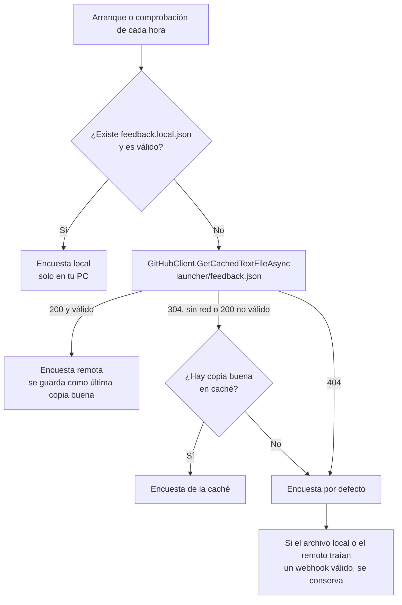
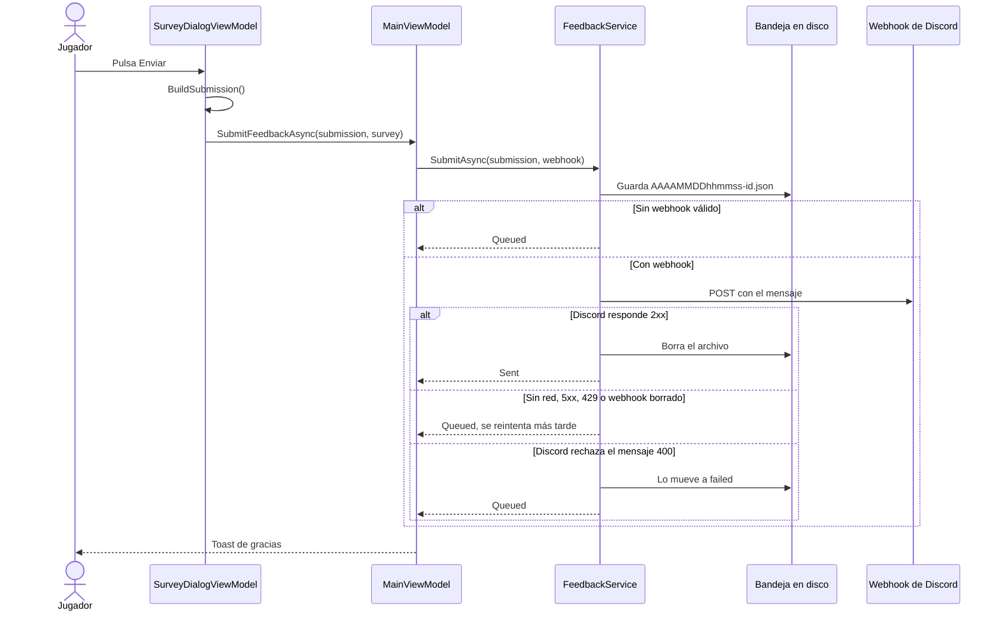

# Encuesta y opiniones (feedback)

Guía para el desarrollador: cómo recibir en un canal de Discord las opiniones de los jugadores, cómo cambiar las
preguntas sin publicar una versión del launcher, cómo probarlo todo antes de que lo vea nadie y cómo ampliar el sistema
en el código.

> Describe el launcher **1.0.4** (la encuesta existe desde la 1.0.3). Índice de toda la documentación:
> [docs/README.md](../README.md). Lista de tareas que solo puedes hacer tú: [TAREAS-MANUALES.md](../operacion/TAREAS-MANUALES.md).

## Contenido

- [Qué es](#qué-es)
- [Guía paso a paso: que las opiniones lleguen a tu Discord](#guía-paso-a-paso-que-las-opiniones-lleguen-a-tu-discord)
- [Cómo funciona por dentro](#cómo-funciona-por-dentro)
- [Qué llega a Discord](#qué-llega-a-discord)
- [La bandeja de salida](#la-bandeja-de-salida)
- [Seguridad del webhook y cómo rotarlo](#seguridad-del-webhook-y-cómo-rotarlo)
- [Cambiar las preguntas](#cambiar-las-preguntas)
- [Buenas prácticas para encuestas de playtest](#buenas-prácticas-para-encuestas-de-playtest)
- [Ampliar el sistema en el código](#ampliar-el-sistema-en-el-código)
- [Reportar un problema: un webhook aparte (1.0.5)](#reportar-un-problema-un-webhook-aparte-105)
- [Problemas típicos](#problemas-típicos)

## Qué es

El launcher pide una opinión rápida a quien juega:

- **Al cerrar el juego**, si la partida duró lo suficiente, aparece un aviso discreto (no bloquea nada):
  «¿Qué tal la partida de 34 min? Tu opinión ayuda a mejorar Coop2D.» con 5 estrellas, **Dar mi opinión**, **Ahora no**
  y **No volver a preguntar**. Pulsar una estrella abre la encuesta con esa valoración ya puesta.
- **Cuando quiera**, con **Enviar opinión** (en Inicio y en el menú **⋯**). Funciona aunque el juego no esté instalado.
- Si el juego se cerró con un error, en lugar de la invitación sale el aviso de cierre inesperado (con «Contarnos qué
  pasó», que abre la misma encuesta).

La encuesta es un diálogo dentro del launcher (≈ 1 minuto). Las respuestas llegan a un **canal de Discord** a través de
un **webhook** (una URL secreta que permite publicar mensajes en ese canal), junto con la versión del juego, la del
launcher y la de Windows. Las preguntas y el webhook se definen en el archivo **`launcher/feedback.json`** del repo
**Coop2D**: cambiarlo cambia la encuesta de todos los launchers **sin sacar versión nueva**.

**Por qué así:**

- **Discord** porque es donde ya está el grupo: no hace falta servidor propio, base de datos ni cuentas. Un webhook es
  gratis, no caduca y se puede revocar en un clic.
- **El JSON en el repo del juego** (y no dentro del launcher) para poder cambiar preguntas y webhook en minutos, con una
  pull request, sin compilar ni publicar nada. Se descarga desde `raw.githubusercontent.com`, que **no gasta cupo de la
  API de GitHub** (ver el límite de 60 consultas por hora en el [README](../../README.md#límites-de-la-api-de-github)).
- **Bandeja de salida en disco** porque los amigos juegan a veces sin internet, o antes de que exista el webhook: una
  respuesta escrita nunca debe perderse.

## Guía paso a paso: que las opiniones lleguen a tu Discord

Unos 15 minutos la primera vez. Al terminar tendrás un canal privado `#feedback` donde aparece un mensaje por cada
respuesta.

> **Sin `feedback.json` no se pierde nada.** Hasta que lo publiques, el launcher usa una
> [encuesta por defecto](#encuesta-por-defecto) y, como no tiene webhook, guarda las respuestas en la
> [bandeja de salida](#la-bandeja-de-salida) de cada PC. Se envían solas en cuanto publiques un `feedback.json` con
> webhook.

### Paso 1. Un servidor y un canal privado

Si ya tenéis servidor de Discord, sáltate el punto 1.

1. **Crear el servidor**: en la barra izquierda de Discord pulsa **+** (Añadir un servidor) → **Crear el mío** →
   **Para mí y mis amigos** → ponle nombre (p. ej. «Coop2D») → **Crear**.
2. **Crear el canal**: junto a «CANALES DE TEXTO» pulsa **+** (Crear canal).
   - Tipo: **Texto** (no «Foro»: en un foro Discord rechaza los mensajes de webhook que no indican un hilo; ver
     [thread_id](#paso-2-crear-el-webhook)).
   - Nombre: `feedback` (o `feedback-coop2d`).
   - Activa **Canal privado** → **Siguiente** → no añadas a nadie (o solo al equipo) → **Crear canal**.

   **Por qué privado:** las respuestas son para el equipo, no para todos los jugadores (algunos escriben cosas
   sinceras que no dirían en público), y así nadie más ve el canal si alguien abusa del webhook.

### Paso 2. Crear el webhook

Necesitas el permiso **Gestionar webhooks** (el dueño del servidor y los administradores lo tienen).

1. Pasa el ratón por encima del canal `#feedback` y pulsa la rueda dentada (**Editar canal**).
2. **Integraciones → Webhooks → Nuevo webhook** (si es el primero, el botón puede llamarse **Crear webhook**).
3. Pulsa el webhook que se acaba de crear (Discord le pone un nombre gracioso). Si quieres, cámbiale el nombre y la
   imagen (por ejemplo el logo de Coop2D): los mensajes del launcher se publican con el nombre **«Coop2D · Feedback»**,
   pero usan la imagen del webhook.
4. **Copiar URL de webhook**. Tiene esta forma (un número y un token largo):
   `https://discord.com/api/webhooks/123456789012345678/AbCdEf…`
5. **Guardar cambios**.

Se aceptan solo URLs `https` de `discord.com`, `discordapp.com`, `ptb.discord.com` o `canary.discord.com` con la ruta
`/api/webhooks/{id}/{token}`; cualquier otra cosa se ignora y las respuestas se quedan en la bandeja de salida. El único
añadido que se respeta es `?thread_id=<número>`, para publicar dentro de un hilo concreto (clic derecho en el hilo →
**Copiar ID del hilo**, con el modo desarrollador de Discord activado en **Ajustes de usuario → Avanzado**); así también
sirve un canal de foro. Lo comprueba `SurveyProvider.NormalizeDiscordWebhook` en
[SurveyProvider.cs](../../src/PalitoLauncher.Core/Feedback/SurveyProvider.cs).

**Comprueba el webhook antes de seguir** (opcional, 30 segundos). En PowerShell:

```powershell
$webhook = "https://discord.com/api/webhooks/123456789012345678/AbCdEf..."   # pega aquí tu URL
Invoke-RestMethod -Uri $webhook -Method Post -ContentType "application/json" -Body '{"content":"Prueba del webhook de Coop2D"}'
```

Si no sale ningún error, en `#feedback` aparece «Prueba del webhook de Coop2D». Un error 404 significa que la URL está
mal copiada o el webhook se borró. Puedes borrar el mensaje de prueba en Discord (pasa el ratón por encima → **⋯ →
Eliminar mensaje**).

### Paso 3. Preparar feedback.json

1. Copia [`feedback.example.json`](../ejemplos/feedback.example.json) (la encuesta de la prueba de diversión del Pre 2) a una
   carpeta tuya, por ejemplo el Escritorio, con el nombre `feedback.json`.
2. **Ofusca la URL** (launcher 1.0.7 o posterior): en el launcher, **Ajustes → Herramientas de desarrollo → Modo
   desarrollador → Ofuscar un webhook**, pega la URL del paso 2 y pulsa **Ofuscar y copiar**. Sale un valor
   `pw1:…`. **Por qué:** hay bots que recorren los repos públicos de GitHub buscando URLs de webhooks de Discord para
   mandar spam; el valor `pw1:` no contiene la URL (ver [Seguridad del webhook](#seguridad-del-webhook-y-cómo-rotarlo)).
3. Ábrelo con el Bloc de notas o VS Code y sustituye
   `pw1:PEGA_AQUI_TU_WEBHOOK_OFUSCADO` por el valor `pw1:…` que copiaste (entre las comillas). Nunca
   pegues la URL tal cual en un archivo que vaya a GitHub.
4. Ajusta las preguntas si quieres (ver [Cambiar las preguntas](#cambiar-las-preguntas)) y **cambia el `id`** si las
   cambias.
5. Guárdalo en **UTF-8** (el Bloc de notas y VS Code lo hacen por defecto). **Por qué importa:** el launcher rechaza
   entero un `feedback.json` remoto que no sea UTF-8 válido (las tildes guardadas en «ANSI» lo romperían) y sigue con la
   copia anterior.
6. Comprueba que el JSON está bien formado:

   ```powershell
   Get-Content "$env:USERPROFILE\Desktop\feedback.json" -Raw -Encoding UTF8 | ConvertFrom-Json | Out-Null   # sin salida = correcto
   ```

Si de momento te basta con la [encuesta por defecto](#encuesta-por-defecto), el archivo puede tener **solo el
webhook**:

```json
{
  "discordWebhookUrl": "pw1:AQIDBAUGBwgcOGKY…"
}
```

### Paso 4. Probarlo en tu PC sin publicar nada (feedback.local.json)

1. Abre la carpeta de datos del launcher: **Win + R** → `%LOCALAPPDATA%\PalitoLauncher` → **Aceptar**.
2. Copia ahí tu archivo con el nombre **`feedback.local.json`**. Tiene prioridad sobre el publicado, **solo en tu PC**.
3. **Cierra el launcher y vuelve a abrirlo** (la encuesta se lee al arrancar).
4. Pulsa **Enviar opinión**: deberías ver tu título y tus preguntas. Responde y pulsa **Enviar**: en unos segundos
   aparece el mensaje en `#feedback` y el launcher muestra «¡Gracias! Tu opinión ya le ha llegado al equipo.».

Para probar también **la invitación al cerrar el juego** sin esperar, pon temporalmente en el archivo local
`"minSessionMinutes": 1` y `"minHoursBetweenPrompts": 0`, abre el juego desde el launcher, juega más de un minuto y
ciérralo. **Antes de publicar, vuelve a poner los valores de verdad.**

Si en lugar de tu encuesta aparece otra, el JSON tiene algún error o ninguna pregunta válida. Abre el log del día,
`%LOCALAPPDATA%\PalitoLauncher\logs\launcher-AAAAMMDD.log`, y busca `Encuesta de feedback`. Cuando todo va bien dice:

```
Encuesta de feedback: se usa el archivo local feedback.local.json («pre2-fun-test», 8 preguntas, webhook: discord.com/api/webhooks/123456789012345678/***).
```

(el token del webhook nunca se escribe en el log: lo tapa `SurveyProvider.DescribeWebhook`). Si algo falla, explica el
motivo y qué preguntas se descartaron.

> **Borra `feedback.local.json` cuando termines.** Mientras exista, tu launcher lo usa e ignora el que publiques en el
> repo.

### Paso 5. Publicar launcher/feedback.json en Coop2D (pull request desde la web)

El archivo va en la carpeta **`launcher/`** de la raíz del repo Coop2D (la misma del fondo remoto `background.png`),
fuera de `Assets/`, así que Unity no lo ve. Como `main` está protegida, se publica con una **pull request** (PR).

1. Entra en el repo **JJJP-Dev/Coop2D** en GitHub, pestaña **Code**, rama `main`.
2. **Add file → Create new file**. (Si el archivo ya existe: ábrelo en `launcher/feedback.json` y pulsa el lápiz
   **Edit this file**.)
3. En el nombre escribe `launcher/feedback.json` (al escribir la `/` se crea la carpeta).
4. Pega el contenido de tu `feedback.json` (sin los valores de prueba).
5. Pulsa **Commit changes…**. En el cuadro:
   - Mensaje, p. ej. `Feedback: encuesta del Pre 2 (prueba de diversión)`.
   - Elige **Create a new branch for this commit and start a pull request** y pon un nombre de rama, p. ej.
     `feedback/pre2-fun-test`.
   - **Propose changes**.
6. En la página siguiente pulsa **Create pull request** (otra vez **Create pull request** si aparece el formulario).
7. Revisa la pestaña **Files changed** (que la URL del webhook sea la buena) y pulsa **Merge pull request → Confirm
   merge**. Después, **Delete branch** para no acumular ramas.
   - Si GitHub dice que hace falta una revisión o una comprobación que no va a llegar y eres administrador del repo,
     puede aparecer la casilla «Merge without waiting for requirements to be met (bypass rules)»; márcala solo si sabes
     que el cambio es correcto.
8. Comprueba que está publicado abriendo
   <https://raw.githubusercontent.com/JJJP-Dev/Coop2D/main/launcher/feedback.json>. raw.githubusercontent.com cachea los
   archivos unos 5 minutos: si ves la versión vieja, espera un poco y recarga.

**Alternativa con git y GitHub CLI** (desde una copia del repo Coop2D):

```powershell
git switch main
git pull
git switch -c feedback/pre2-fun-test
New-Item -ItemType Directory -Force launcher | Out-Null
Copy-Item C:\ruta\a\tu\feedback.json launcher\feedback.json   # la que probaste, sin los valores de prueba
git add launcher/feedback.json
git commit -m "Feedback: encuesta del Pre 2 (prueba de diversión)"
git push -u origin feedback/pre2-fun-test
gh pr create --repo JJJP-Dev/Coop2D --base main --title "Feedback: encuesta del Pre 2" --body "Encuesta de la prueba de diversión."
gh pr merge --squash --delete-branch
```

### Paso 6. Comprobar que funciona en los launchers

1. **Borra tu `feedback.local.json`** (si no, tu launcher seguirá usando el local).
2. Cierra y abre el launcher. En el log debe aparecer `Encuesta de feedback: «pre2-fun-test» (8 preguntas, webhook:
   discord.com/api/webhooks/…/***).` (sin «archivo local»).
3. Envía una opinión de prueba con **Enviar opinión** y comprueba que llega a `#feedback`. Bórrala en Discord si quieres.
4. Tus amigos no tienen que hacer nada: cada launcher recoge el archivo nuevo **al abrirse** y en la **comprobación de
   cada hora** (si el launcher no está ocupado ni con el juego abierto). Si alguien tenía opiniones guardadas, se envían
   solas en ese momento; también puede forzarlo con **Ajustes → Juego → Reintentar envío**, que vuelve a leer
   `feedback.json` antes de enviar.

### Paso 7. Que Discord te avise de cada respuesta

Los mensajes del launcher **no mencionan a nadie** (el launcher desactiva las menciones a propósito para que nadie pueda
escribir `@everyone` en una respuesta), así que Discord no te avisará salvo que se lo pidas:

1. Clic derecho en `#feedback` → **Ajustes de notificaciones** → **Todos los mensajes**.
2. En el móvil, con la app de Discord instalada y las notificaciones activadas, te llegará un aviso por respuesta.

Para dejar de invitar al cerrar el juego sin quitar la encuesta, publica el mismo archivo con
`"askAfterSession": false` (el botón **Enviar opinión** sigue funcionando).

## Cómo funciona por dentro

| Pieza | Archivo | Qué hace |
|---|---|---|
| Modelos | [SurveyModels.cs](../../src/PalitoLauncher.Core/Feedback/SurveyModels.cs) | `SurveyDefinition`, `SurveyQuestion`, `SurveyQuestionType`, `SurveyAnswer`, `FeedbackSubmission`, `FeedbackTrigger`, `FeedbackSendOutcome` |
| Encuesta | [SurveyProvider.cs](../../src/PalitoLauncher.Core/Feedback/SurveyProvider.cs) | `GetSurveyAsync` (local → remota → por defecto), `Parse`, `Sanitize`, `CreateDefault`, validación del webhook |
| Envío | [FeedbackService.cs](../../src/PalitoLauncher.Core/Feedback/FeedbackService.cs) | `SubmitAsync`, `FlushOutboxAsync`, `PendingCount`, `BuildDiscordPayload`, `ShouldPromptAfterSession` |
| Descarga con caché | [GitHubClient.cs](../../src/PalitoLauncher.Core/GitHub/GitHubClient.cs) | `GetCachedTextFileAsync`: descarga con ETag, valida y guarda la última copia buena |
| Orquestación (UI) | [MainViewModel.Feedback.cs](../../src/PalitoLauncher/ViewModels/MainViewModel.Feedback.cs) | Carga la encuesta al arrancar, mide la partida, muestra la invitación, abre el diálogo, vacía la bandeja |
| Diálogo | [SurveyDialogViewModel.cs](../../src/PalitoLauncher/ViewModels/SurveyDialogViewModel.cs) y [SurveyDialogView.xaml](../../src/PalitoLauncher/Views/SurveyDialogView.xaml) | Validación de obligatorias, apodo, «Enviando…», confirmaciones al cancelar o cerrar |
| Preguntas (UI) | [SurveyQuestionViewModels.cs](../../src/PalitoLauncher/ViewModels/SurveyQuestionViewModels.cs) | Un ViewModel por tipo (`RatingQuestionViewModel`, `ScaleQuestionViewModel`…) |
| Configuración | [LauncherConfig.cs](../../src/PalitoLauncher.Core/LauncherConfig.cs) y [AppPaths.cs](../../src/PalitoLauncher.Core/AppPaths.cs) | `RemoteFeedbackConfigUrl`, `FeedbackOutboxDir` |
| Ajustes del jugador | [LauncherSettings.cs](../../src/PalitoLauncher.Core/Settings/LauncherSettings.cs) | `AskFeedbackAfterSession`, `FeedbackNickname`, `LastFeedbackPromptUtc` |

La regla de diseño es la misma que en el resto del launcher: **la lógica vive en `PalitoLauncher.Core`** (sin WPF, con
tests) y la UI solo la llama. Nada de la encuesta puede romper el launcher: cada fallo se registra en el log y se usa un
valor seguro (la encuesta por defecto, la bandeja de salida).

### Cómo elige el launcher la encuesta

`MainViewModel.InitializeFeedbackAsync` la pide al arrancar (en segundo plano, después de las releases) y
`PeriodicFeedbackAsync` la refresca en la comprobación de cada hora. Ambas acaban en `SurveyProvider.GetSurveyAsync`:



Detalles:

- El archivo se valida y se **sanea** (`SurveyProvider.Sanitize`): lo que no cumple las reglas se recorta o se descarta
  en silencio y queda una línea de aviso en el log. Un archivo que no es JSON válido, o con preguntas pero ninguna
  válida, no se usa.
- Si publicas un JSON roto, los launchers que ya tenían una versión buena **siguen con ella** (la caché solo se
  sustituye por archivos válidos); los que no, usan la encuesta por defecto.
- Si borras el archivo del repo (404), los launchers borran su caché y vuelven a la encuesta por defecto, sin webhook.
- La caché está en `%LOCALAPPDATA%\PalitoLauncher\cache\feedback.json` (+ `feedback.json.meta.json` con el ETag). Cada
  lectura hace una petición condicional a raw.githubusercontent.com: si no cambió, responde 304 y no se descarga nada.
- El diálogo usa la encuesta ya cargada; si al abrirlo aún no ha llegado, espera como mucho 4 s
  (`SurveyLoadTimeout`) y si no, usa la de por defecto. **Por qué:** el jugador nunca debe quedarse mirando un spinner.

### Cuándo se invita a responder

La invitación al cerrar el juego sale solo si `FeedbackService.ShouldPromptAfterSession` devuelve `true`, es decir, si
se cumplen **todas** estas condiciones:

- El jugador tiene activado **Ajustes → Juego → Pedirme opinión al cerrar el juego** (activado por defecto; el enlace
  **No volver a preguntar** lo desactiva).
- La encuesta tiene `askAfterSession: true`.
- La partida duró al menos `minSessionMinutes` minutos (cuenta desde que el launcher abre el juego o se engancha a uno ya
  abierto).
- Han pasado al menos `minHoursBetweenPrompts` horas desde la última invitación en ese PC (o la hora de Windows
  retrocedió).

Además: si la ventana estaba minimizada (el juego la minimiza según los ajustes), la invitación espera a que se
restaure; se oculta sola si empieza otra partida; y si el juego se cerró con error, sale el aviso de cierre inesperado en
su lugar.

El botón **Enviar opinión** funciona siempre, con cualquier configuración. Para evitar dobles envíos, cada launcher
abierto acepta como mucho una opinión cada 30 segundos (`FeedbackService.MinIntervalBetweenSubmissions`).

### Cómo se envía una respuesta



**Por qué se guarda en disco antes de enviar:** si el PC se apaga, no hay internet o Discord falla a mitad, la respuesta
ya está a salvo y se reintenta más tarde. Se borra solo cuando Discord confirma que la ha recibido.

Los toasts dicen la verdad de lo que pasó (`MainViewModel.FeedbackResultToast`):

| Resultado | Toast |
|---|---|
| Enviada | «¡Gracias! Tu opinión ya le ha llegado al equipo.» |
| En la bandeja, con webhook (fallo de red o de Discord) | «¡Gracias! Se enviará en cuanto haya conexión.» |
| En la bandeja porque la encuesta no tiene webhook | «¡Gracias! Tu opinión se ha guardado y se enviará en cuanto el equipo active los envíos.» |

### Encuesta por defecto

Es la que ven todos mientras no haya `feedback.json` (`SurveyProvider.CreateDefault`, Id `default`, sin webhook). Sirve
como punto de partida: usa los mismos Ids si quieres comparar respuestas.

| Id | Tipo | Pregunta |
|---|---|---|
| `overall` | rating, obligatoria | En general, ¿qué tal la partida? |
| `again` | choice, obligatoria | ¿Te apetece volver a jugar? (Sí, otra partida ya / Sí, otro día / No mucho) |
| `difficulty` | scale 1..5 | ¿Qué tal la dificultad? (Muy fácil … Muy difícil) |
| `players` | choice | ¿Cuántos jugabais? (Solo / 2 / 3 / 4) |
| `issues` | multi | ¿Tuviste algún problema? (Lag o desconexiones / El juego se cerró / Va lento o a tirones / Fallos visuales / Controles incómodos / Ninguno) |
| `best` | text | ¿Qué fue lo mejor? |
| `improve` | text | ¿Qué cambiarías o mejorarías? |

## Qué llega a Discord

Cada respuesta es un mensaje del webhook con el nombre **Coop2D · Feedback** y una tarjeta (embed) así:

```
Opinión · Coop2D 0.0.3 · Prototipo 2
  En general, ¿qué tal la partida?                         ★★★★☆ (4/5)
  ¿Fue divertido combinar elementos con tus compañeros?    5 / 5 (Muy divertido)
  ¿Entendiste cuándo detonar una reacción?                 Más o menos
  ¿Tuviste algún problema?                                 Lag o desconexiones · Fallos visuales
  ¿Qué cambiarías para que combinar elementos fuera…?      Que el vapor dure un poco más…
  Jugador: Marta     Partida: 34 min · salió bien     Encuesta: pre2-fun-test
Launcher 1.0.4 · Windows 10.0.26100 · hoy a las 21:14
```

- **Título**: la versión del juego que se jugó («versión desconocida» si no lo tiene instalado). Tras una partida es la
  versión de **esa** partida, aunque el launcher se haya actualizado mientras tanto.
- **Color** de la barra lateral según la primera valoración `rating` respondida: 1-2 rojo, 3 ámbar, 4-5 verde, sin
  valoración azul. Así se ve de un vistazo cómo fue la sesión.
- **Un campo por pregunta respondida**, en el orden de la encuesta. Las que se dejaron en blanco no aparecen.
- **Jugador**: el nombre o apodo que escribió (opcional, se recuerda para la próxima vez) o «Anónimo».
- **Partida**: duración y cómo terminó («34 min · salió bien», o «código X» si el juego se cerró mal) cuando la opinión
  viene de la invitación al cerrar el juego, o «Enviada desde «Enviar opinión»» si la mandó a mano.
- **Encuesta**: el `id` de la encuesta, para saber qué versión de las preguntas respondió.
- **Pie**: versión del launcher y de Windows, y la fecha de la respuesta (la de cuando se escribió, aunque llegue más
  tarde desde la bandeja de salida).
- Las menciones (`@everyone`, `@usuario`) que alguien escriba no avisan a nadie, y los textos muy largos se recortan con
  «…» para cumplir los límites de Discord (25 campos y 6000 caracteres por tarjeta).

Todo esto lo construye `FeedbackService.BuildDiscordPayload`, que no hace E/S y por eso tiene tests que comprueban el
JSON exacto ([FeedbackServiceTests.cs](../../tests/PalitoLauncher.Tests/FeedbackServiceTests.cs)).

## La bandeja de salida

Cada respuesta se guarda **siempre** primero en disco y se borra solo cuando Discord confirma que la ha recibido, así
que no se pierde aunque no haya internet, falte el webhook o Discord falle.

- Carpeta: `%LOCALAPPDATA%\PalitoLauncher\feedback\outbox\` (`AppPaths.FeedbackOutboxDir`), un archivo JSON por
  respuesta (`AAAAMMDDhhmmss-<id>.json`) con las preguntas tal como se mostraron y las respuestas, así que se formatean
  bien aunque cambies la encuesta después.
- Se reintenta **al abrir el launcher** (hasta 10 respuestas cada vez, de la más antigua a la más nueva), en la
  **comprobación de cada hora** si hay alguna pendiente, y con **Ajustes → Juego → Reintentar envío**, que aparece junto
  a «N opiniones pendientes de enviar» cuando hay alguna.
- Si la encuesta no tiene webhook, Ajustes dice «N opiniones pendientes: se enviarán cuando el equipo active los envíos»
  (sin color de aviso: no es un problema del jugador).

| Qué pasa al enviar | Qué hace el launcher |
|---|---|
| Discord la acepta (2xx) | La borra de la bandeja |
| Sin internet, tiempo agotado o Discord caído (5xx) | La deja en la bandeja y lo reintenta más tarde |
| Demasiados mensajes (429) | Espera lo que diga Discord (si son 3 s o menos, en el momento) y la deja en la bandeja |
| Webhook borrado o no válido (401/403/404), o sin webhook | La deja en la bandeja hasta que haya un webhook válido en el JSON |
| Discord rechaza el mensaje (400/413/422) | La mueve a `outbox\failed\` para no reintentar sin fin (el motivo queda en el log) |
| Archivo de la bandeja dañado | Lo mueve a `outbox\failed\` |

Los archivos de `failed\` se pueden abrir con cualquier editor para leer la respuesta a mano. Si arreglas la causa,
devolverlos a `outbox\` hace que se reintenten.

**Ojo:** la bandeja es de **cada PC**. Tú no puedes ver las bandejas de tus amigos; si alguien dice que «no se
envía», pídele una captura de **Ajustes → Juego** o el informe (**⋯ → Crear informe para el desarrollador**), que
incluye los logs.

## Seguridad del webhook y cómo rotarlo

**Qué se envía**: las respuestas, el apodo si lo escribe, la versión del juego, la del launcher, la de Windows (p. ej.
«Microsoft Windows 10.0.26100»), la duración de la partida y el código de salida del juego si viene de la invitación, y
la fecha. **No** se envían el nombre de usuario de Windows, el nombre del PC, rutas, archivos ni identificadores del
equipo. Como en cualquier conexión a internet, Discord ve la IP desde la que llega el mensaje, pero no la muestra en el
canal. El diálogo de la encuesta lo explica en una línea al pie (`SurveyDialogViewModel.FooterNote`).

**La URL del webhook es la contraseña del canal.** Con ella se puede publicar en **ese** canal, editar o borrar los
mensajes que publicó ese webhook y cambiar o borrar el propio webhook, pero no leer el canal ni tocar nada más del
servidor. Y el repo Coop2D es público: cualquiera puede leer `launcher/feedback.json`.

**Bots de spam.** Hay bots que recorren todos los repos públicos de GitHub buscando el texto
`discord.com/api/webhooks/…` y, en cuanto encuentran uno, lo usan para publicar anuncios (cripto, Telegram…). Nos pasó
con el webhook en texto plano. Por eso, desde el launcher **1.0.7**, los webhooks de `feedback.json`, `launcher.json` y
`missions.json` se escriben **ofuscados**:

- Valor `pw1:…` en lugar de la URL, generado en **Ajustes → Herramientas de desarrollo → Ofuscar un webhook** (con el
  modo desarrollador activado). Cada vez sale un valor distinto y todos valen. Código:
  [`WebhookObfuscation.cs`](../../src/PalitoLauncher.Core/Feedback/WebhookObfuscation.cs).
- **No es cifrado de verdad**: la clave va dentro del launcher, cuyo código es público, así que alguien que quiera de
  verdad puede descifrarlo. Lo que evita es que lo encuentren los rastreadores automáticos, que es lo que pasa en la
  práctica. La protección real será un servidor intermedio que guarde los webhooks (pendiente, junto con privatizar los
  repos).
- Una URL en texto plano **se sigue aceptando**, pero el launcher avisa en el log («El webhook de feedback.json está en
  texto plano…»).
- Los launchers **1.0.6 o anteriores no entienden `pw1:`**: para ellos es como no tener webhook, así que guardan las
  opiniones en su bandeja y las envían en cuanto se actualizan solos a la 1.0.7. No se pierde nada.

Además:

- Usa un **canal privado dedicado** solo a las opiniones.
- No pongas el webhook en el código del launcher ni en otro sitio: solo en los JSON del repo del juego, para poder
  cambiarlo sin publicar versión.
- No lo pegues (ni el `pw1:`) en chats públicos ni en capturas, ni en archivos del repo del launcher.

**Cómo rotarlo** (si alguien lo usa para spam, si se filtró, o por higiene cuando alguien deja el equipo):

1. En Discord: `#feedback` → **Editar canal → Integraciones → Webhooks**, abre el webhook y pulsa **Eliminar webhook**.
   El spam se corta al momento.
2. Crea un webhook nuevo ([paso 2](#paso-2-crear-el-webhook)) y **ofúscalo** ([paso 3](#paso-3-preparar-feedbackjson)).
3. Actualiza `discordWebhookUrl` en `launcher/feedback.json` con el valor `pw1:…` nuevo, con una pull request
   ([paso 5](#paso-5-publicar-launcherfeedbackjson-en-coop2d-pull-request-desde-la-web)).

**No hace falta sacar versión del launcher.** Mientras tanto, las respuestas de tus amigos esperan en su bandeja de
salida (el webhook borrado responde 404) y llegan solas cuando su launcher recoge el JSON nuevo.

## Cambiar las preguntas

Cambiar preguntas es **solo editar JSON**: no hace falta tocar código ni publicar el launcher. Flujo recomendado:

1. Copia el `feedback.json` publicado, cambia las preguntas y **sube el `id`** de la encuesta (`pre2-fun-test` →
   `pre2-fun-test-2`).
2. Pruébalo en tu PC como `feedback.local.json` ([paso 4](#paso-4-probarlo-en-tu-pc-sin-publicar-nada-feedbacklocaljson)).
3. Publícalo con una PR ([paso 5](#paso-5-publicar-launcherfeedbackjson-en-coop2d-pull-request-desde-la-web)) y borra el
   archivo local.

### Esquema del JSON

JSON en UTF-8 con nombres de campo en **camelCase**, como en el [ejemplo](#ejemplo-completo-pre-2) (el launcher no
distingue mayúsculas en los nombres). También tolera comentarios `//` y comas finales, pero mejor no usarlos: así
cualquier editor o validador acepta el archivo. Los campos desconocidos se ignoran y el archivo puede ocupar como mucho
256 KB (de sobra).

**Encuesta** (`SurveyDefinition`):

| Campo | Tipo | Por defecto | Reglas |
|---|---|---|---|
| `id` | texto | `"default"` | Identifica la encuesta en Discord (p. ej. `"pre2-fun-test"`). Letras, números, `-`, `_` y `.`, máx. 64 (el resto de caracteres se quita). **Cámbialo cuando cambies las preguntas.** |
| `title` | texto | `"Tu opinión sobre Coop2D"` | Título del diálogo, en una línea. Máx. 120 caracteres. Vacío → el valor por defecto. |
| `intro` | texto o `null` | `null` | Texto bajo el título. Máx. 300 caracteres. Admite saltos de línea (`\n`). |
| `askAfterSession` | `true` / `false` | `true` | `false` = no invitar al cerrar el juego (el botón manual sigue funcionando). |
| `minSessionMinutes` | número | `5` | Minutos mínimos de partida para invitar. Se limita a 1..120. |
| `minHoursBetweenPrompts` | número | `12` | Horas mínimas entre dos invitaciones en el mismo PC. Se limita a 0..168. |
| `discordWebhookUrl` | texto o `null` | `null` | URL del webhook ([paso 2](#paso-2-crear-el-webhook)). Si falta o no es válida, las respuestas esperan en la bandeja de salida. |
| `questions` | lista | — | De 1 a 12 preguntas; a partir de la 12.ª se ignoran. |

**Pregunta** (`SurveyQuestion`):

| Campo | Tipo | Para | Por defecto | Reglas |
|---|---|---|---|---|
| `id` | texto | todas | — | **Obligatorio.** Solo letras, números, `-` y `_`, máx. 64 (p. ej. `"overall"`, `"combo-fun"`). Único dentro de la encuesta (sin distinguir mayúsculas). |
| `type` | texto | todas | — | **Obligatorio.** `"rating"`, `"scale"`, `"choice"`, `"multi"` o `"text"` (sin distinguir mayúsculas). |
| `text` | texto | todas | — | **Obligatorio.** La pregunta, en una línea. Máx. 200 caracteres. |
| `hint` | texto o `null` | todas | `null` | Ayuda en gris bajo la pregunta. Máx. 200 caracteres. |
| `required` | `true` / `false` | todas | `false` | Obligatoria: **Enviar** no se activa hasta que esté respondida. |
| `options` | lista de textos | choice, multi | `[]` | De 2 a 10 opciones, cada una de máx. 80 caracteres. Las vacías y las repetidas (sin distinguir mayúsculas) se quitan. |
| `min` / `max` | número | scale | `1` / `5` | Rango 0..10 con `min` < `max` (si están al revés se intercambian; si son iguales, 1..5). |
| `minLabel` / `maxLabel` | texto o `null` | scale | `null` | Etiquetas bajo los extremos (p. ej. «Muy fácil» / «Muy difícil»). Máx. 60 caracteres. |
| `maxLength` | número | text | `1000` | Caracteres máximos de la respuesta. Se limita a 1..1000 (límite de Discord). |
| `placeholder` | texto o `null` | text | `null` | Texto de ejemplo en gris dentro de la caja vacía. Máx. 200 caracteres. |

Los campos que no corresponden al tipo (por ejemplo `options` en una `rating`) se ignoran.

### Tipos de pregunta, con ejemplos

| `type` | Cómo se ve | Cómo llega a Discord |
|---|---|---|
| `rating` | 5 estrellas grandes (ratón, teclado ← → o 1-5) | `★★★★☆ (4/5)` |
| `scale` | Una fila de botones de `min` a `max` con las etiquetas debajo de los extremos | `4 / 5 (Muy difícil)` (la etiqueta solo si es un extremo) |
| `choice` | Botones «píldora»: se elige **una** opción | La opción |
| `multi` | Píldoras: se eligen **varias**. Una opción llamada exactamente **«Ninguno»** o **«Ninguna»** es exclusiva: al marcarla se desmarcan las demás, y al revés | Opciones separadas por ` · ` |
| `text` | Caja de texto de 3-4 líneas con contador «123 / 1000» | El texto |

**rating**: valoración general. La **primera pregunta `rating`** es especial: las estrellas de la invitación la rellenan
y su valor da color al mensaje de Discord. Ponla la primera y obligatoria.

```json
{ "id": "overall", "type": "rating", "text": "En general, ¿qué tal la partida?", "required": true }
```

**scale**: «cuánto» de algo, con etiquetas en los extremos. El número alto siempre debería significar «más».

```json
{
  "id": "difficulty", "type": "scale", "text": "¿Qué tal la dificultad?",
  "min": 1, "max": 5, "minLabel": "Muy fácil", "maxLabel": "Muy difícil"
}
```

**choice**: una respuesta entre varias. Incluye una salida para quien no sabe («No me fijé»).

```json
{
  "id": "favorite-reaction", "type": "choice", "text": "¿Qué reacción te gustó más?",
  "options": ["Electrocución", "Vapor", "Sobrecarga", "No me fijé"]
}
```

**multi**: marcar todas las que apliquen. «Ninguno» se desmarca solo al marcar otra.

```json
{
  "id": "issues", "type": "multi", "text": "¿Tuviste algún problema?", "hint": "Marca todos los que quieras.",
  "options": ["Lag o desconexiones", "El juego se cerró", "Va lento o a tirones", "Ninguno"]
}
```

**text**: respuesta libre. Siempre opcional y concreta.

```json
{
  "id": "improve", "type": "text", "text": "¿Qué cambiarías o mejorarías?",
  "maxLength": 500, "placeholder": "Lo que te frustró, lo que echaste de menos…"
}
```

Las opciones pueden ir sin comillas si son números (`"options": [2, 3, 4]`), pero mejor entre comillas.

### Qué se descarta o recorta al sanear

`SurveyProvider.Sanitize` hace esto (y deja una línea `Encuesta de feedback «id»: se descartan N preguntas: …` en el
log):

- **Se descarta la pregunta** si: su `id` no es válido o está repetido, no tiene `text`, su `type` no existe, o es
  `choice`/`multi` con menos de 2 opciones válidas.
- **Se recorta**: textos más largos que su máximo (terminan en «…»), opciones de más (quedan 10), preguntas de más
  (quedan 12). Los saltos de línea solo se respetan en `intro`.
- **Se limpian** caracteres de control y marcas de dirección de texto (podrían falsear lo que se muestra).
- **Se ajusta al rango**: `min`/`max` de las escalas, `maxLength`, `minSessionMinutes` y `minHoursBetweenPrompts`.
- **Se ignora** `discordWebhookUrl` si no es un webhook de Discord válido.

**Por qué sanear en vez de rechazar:** un error tonto en una pregunta (una opción repetida, un texto largo) no debe
dejar a todos sin encuesta. Solo se rechaza el archivo entero si no queda ninguna pregunta válida.

### Ejemplo completo (Pre 2)

El milestone **Pre 2 · Gameplay prototype** pregunta «¿es divertido combinar elementos con un compañero?», así que la
encuesta de la prueba de diversión se centra en eso. Está lista para copiar en
[`docs/ejemplos/feedback.example.json`](../ejemplos/feedback.example.json) (cambia el placeholder del webhook por tu URL; tal cual, se ignora
y las respuestas se quedan en la bandeja). El test `SurveyProviderTests.Parse_DocsExampleFile_IsAccepted` comprueba que
ese archivo sigue siendo válido: si lo editas y lo rompes, la CI falla.

```json
{
  "id": "pre2-fun-test",
  "title": "Prueba de diversión · Prototipo 2",
  "intro": "Estamos comprobando si combinar elementos con tus compañeros es divertido. Responde con sinceridad: si algo no divierte, es justo lo que necesitamos saber.",
  "askAfterSession": true,
  "minSessionMinutes": 5,
  "minHoursBetweenPrompts": 12,
  "discordWebhookUrl": "pw1:PEGA_AQUI_TU_WEBHOOK_OFUSCADO",
  "questions": [
    {
      "id": "overall",
      "type": "rating",
      "text": "En general, ¿qué tal la partida?",
      "required": true
    },
    {
      "id": "combo-fun",
      "type": "scale",
      "text": "¿Fue divertido combinar elementos con tus compañeros?",
      "required": true,
      "min": 1,
      "max": 5,
      "minLabel": "Nada divertido",
      "maxLabel": "Muy divertido"
    },
    {
      "id": "detonate-clear",
      "type": "choice",
      "text": "¿Entendiste cuándo detonar una reacción?",
      "hint": "Según lo que notaste jugando, no lo que te hayan explicado.",
      "required": true,
      "options": [
        "Sí, lo tuve claro",
        "Más o menos",
        "No, las reacciones salían por casualidad"
      ]
    },
    {
      "id": "favorite-reaction",
      "type": "choice",
      "text": "¿Qué reacción te gustó más?",
      "options": [
        "Electrocución",
        "Vapor",
        "Sobrecarga",
        "No me fijé"
      ]
    },
    {
      "id": "again",
      "type": "choice",
      "text": "¿Te apetece volver a jugar?",
      "options": [
        "Sí, otra partida ya",
        "Sí, otro día",
        "No mucho"
      ]
    },
    {
      "id": "players",
      "type": "choice",
      "text": "¿Cuántos jugabais?",
      "options": [
        "Solo",
        "2",
        "3",
        "4"
      ]
    },
    {
      "id": "issues",
      "type": "multi",
      "text": "¿Tuviste algún problema?",
      "hint": "Marca todos los que quieras.",
      "options": [
        "Lag o desconexiones",
        "El juego se cerró",
        "Va lento o a tirones",
        "Fallos visuales",
        "Controles incómodos",
        "Ninguno"
      ]
    },
    {
      "id": "improve",
      "type": "text",
      "text": "¿Qué cambiarías para que combinar elementos fuera más divertido?",
      "maxLength": 1000,
      "placeholder": "Lo que se te ocurra: qué sobraba, qué faltaba, qué te frustró…"
    }
  ]
}
```

Por qué así:

- **3 obligatorias** (`overall`, `combo-fun`, `detonate-clear`): son las que responden a la pregunta del milestone. El
  resto es opcional para que nadie abandone a medias.
- `combo-fun` es una escala con etiquetas para medir **cuánto** divierte; `detonate-clear` comprueba si las reglas de
  aura y detonante se entienden **sin explicarlas** (por eso la ayuda no da pistas).
- `again`, `players` e `issues` usan **los mismos Ids y opciones que la encuesta por defecto**: así se pueden comparar
  con las respuestas de antes y de después del Pre 2.
- Una sola pregunta de texto, opcional y concreta, al final.

## Buenas prácticas para encuestas de playtest

**Siempre:**

- **Pocas preguntas**: 5-8 (≈ 1 minuto; el diálogo calcula y muestra la duración estimada). Se admiten 12, pero cada
  pregunta de más hace que menos gente termine.
- **Empieza por una valoración `rating` obligatoria**: la rellenan las estrellas de la invitación y colorea el mensaje.
- **2-3 obligatorias como mucho**, y las de texto siempre opcionales.
- **Pregunta por la duda del milestone.** Cada milestone de Coop2D tiene su «Pregunta:» (Pre 2: «¿es divertido combinar
  elementos con un compañero?»; Pre 3: «¿una partida entera tiene ritmo?»): la encuesta debería ayudarte a responderla.
  Ver [ROADMAP.md](ROADMAP.md).
- **Una idea por pregunta y redacción neutra**: «¿Fue divertido…?» con una escala, no «¿Verdad que fue divertido?». No
  des la respuesta en la ayuda.
- **Opciones que no se solapen** y una salida para quien no sabe o no tuvo problemas («No me fijé», «Ninguno»).
- **Cambia el `id` de la encuesta cuando cambien las preguntas** (`pre2-fun-test` → `pre2-fun-test-2`, `pre3-pacing`…):
  en Discord sabrás qué versión respondió cada uno.
- **Mantén los mismos Ids de pregunta** (`overall`, `again`, `players`, `issues`…) mientras la pregunta signifique lo
  mismo, para comparar entre versiones del juego. Si cambias el sentido de una pregunta, dale un Id nuevo; nunca
  reutilices un Id para otra cosa.
- **Escalas siempre en la misma dirección** (el número alto = «más»), con etiquetas en los extremos.
- **Ajusta los tiempos a la sesión**: `minSessionMinutes` algo menor que una partida normal (para no preguntar tras una
  prueba de 30 segundos) y `minHoursBetweenPrompts` para preguntar una vez por sesión de juego, no tras cada partida.
- **Publica la encuesta antes de la sesión de playtest** (y pruébala en local): los launchers la recogen al abrirse.
- **Cierra el círculo**: cuenta en las notas de la siguiente release qué cambiaste gracias a las respuestas. Es lo que
  hace que la gente siga respondiendo.

**Con 4-5 amigos (ahora):**

- Cada respuesta cuenta mucho y los porcentajes no significan nada (1 persona = 20 %). Da más peso a las preguntas de
  **texto** y a lo que os contéis en voz después de jugar; la encuesta sirve para que nada se olvide.
- Pide el **apodo** (es opcional, pero con pocos jugadores ayuda a entender el contexto: «Marta jugó sola»).
- Puedes cambiar la encuesta en cada sesión: con tan poca gente, comparar entre versiones importa menos que preguntar
  justo lo que quieres saber hoy.
- `minHoursBetweenPrompts` alto (12-24 h): jugáis sesiones largas y basta con una respuesta por persona y sesión.

**Con grupos más grandes (más adelante):**

- Más preguntas **cerradas** (`rating`, `scale`, `choice`) y menos texto: con 20-50 respuestas por sesión, leer textos
  largos no escala y las cerradas se pueden contar.
- **Congela los Ids y las opciones** de las preguntas de seguimiento (`overall`, `again`, `issues`) y no las cambies
  entre versiones: así podrás ver la tendencia de una build a otra.
- Una encuesta por fase o por objetivo, no por sesión, y siempre con `id` nuevo.
- Si el canal se llena, usa un **hilo por sesión** con `?thread_id=` en el webhook (ver
  [paso 2](#paso-2-crear-el-webhook)) para separar las respuestas de cada playtest.
- No hagas obligatorias más preguntas por tener más gente: la tasa de respuesta baja igual.

## Ampliar el sistema en el código

Esta sección es para cuando quieras **cambiar cómo funciona** la encuesta (no solo sus preguntas). Para las recetas
generales (añadir un ajuste, una página, un texto…) y cómo ejecutar los tests, ver [GUIA-CODIGO.md](../codigo/GUIA-CODIGO.md).

### Mapa: qué archivo tocar para qué

| Quiero… | Toca |
|---|---|
| Cambiar un límite (máx. preguntas, longitudes) | Constantes al principio de `SurveyProvider` (`MaxQuestions`, `MaxQuestionTextLength`…) |
| Cambiar la encuesta por defecto | `SurveyProvider.CreateDefault` (y su test `SurveyProviderTests.CreateDefault_MatchesSpecification`) |
| Cambiar cuándo se invita | `FeedbackService.ShouldPromptAfterSession` y `MainViewModel.MaybePromptFeedbackAsync` |
| Cambiar el formato del mensaje de Discord | `FeedbackService.BuildDiscordPayload` (y `FormatAnswer`, `FormatSession`, `BuildFooter`) |
| Cambiar el nombre con el que publica | `FeedbackService.Username` |
| Cambiar los textos de los toasts | Constantes `FeedbackSentToast`, `FeedbackQueuedToast`… en `MainViewModel.Feedback.cs` |
| Cambiar el aspecto del diálogo | [SurveyDialogView.xaml](../../src/PalitoLauncher/Views/SurveyDialogView.xaml) (plantillas por tipo en `UserControl.Resources`) |
| Apuntar a otro repo o archivo | `LauncherConfig.RemoteFeedbackConfigUrl` |

### Receta: un tipo de pregunta nuevo

Ejemplo: un tipo `yesNo` (dos botones «Sí» / «No»). Los nombres `YesNo` y `YesNoQuestionViewModel` son **nuevos**: los
creas tú siguiendo estos pasos.

1. **Modelo** — en [SurveyModels.cs](../../src/PalitoLauncher.Core/Feedback/SurveyModels.cs) añade `YesNo` **al final** del
   enum `SurveyQuestionType`. No hace falta tocar el parser: `SurveyProvider.ParseType` acepta cualquier nombre del enum
   sin distinguir mayúsculas, así que `"type": "yesNo"` ya se reconoce. Decide dónde va la respuesta en `SurveyAnswer`
   (`Number`, `Choices` o `Text`); para Sí/No basta `Choices` con un elemento.
2. **Saneado** — en `SurveyProvider.SanitizeQuestion` decide qué campos aplican al tipo nuevo. Si necesita un campo
   propio en el JSON, añádelo como propiedad en `SurveyQuestion`, léelo en `SurveyProvider.ReadQuestion` (con `GetString`
   / `GetInt` / `GetBool`) y límpialo en `SanitizeQuestion` (con `FeedbackText.Clean` para textos).
3. **ViewModel** — en [SurveyQuestionViewModels.cs](../../src/PalitoLauncher/ViewModels/SurveyQuestionViewModels.cs) crea
   `YesNoQuestionViewModel : SurveyQuestionViewModel` que implemente `IsAnswered` y `BuildAnswer()` y llame a
   `NotifyAnswerChanged()` cuando cambie la respuesta (así el diálogo recalcula si se puede enviar). Puedes copiar
   `ChoiceQuestionViewModel`. Después añade el caso en la fábrica:

   ```csharp
   public static SurveyQuestionViewModel? Create(SurveyQuestion question, int number) => question?.Type switch
   {
       SurveyQuestionType.Rating => new RatingQuestionViewModel(question, number),
       // ...
       SurveyQuestionType.YesNo => new YesNoQuestionViewModel(question, number),   // nuevo
       _ => null,
   };
   ```

   Si olvidas este paso, `Create` devuelve `null` y la pregunta **no se muestra** (sin error).
4. **Vista** — en [SurveyDialogView.xaml](../../src/PalitoLauncher/Views/SurveyDialogView.xaml), dentro de
   `UserControl.Resources`, añade una plantilla con `DataType="{x:Type vm:YesNoQuestionViewModel}"`. WPF elige la
   plantilla por el tipo del ViewModel; sigue el modelo de la de `ChoiceQuestionViewModel` (estilo `PillRadio`).
5. **Mensaje de Discord** — en `FeedbackService.FormatAnswer` añade el `case` del tipo nuevo. Si no, cae en
   `default => null` y **la respuesta no se envía** (desaparece en silencio del mensaje).
6. **Tests**:
   - [SurveyProviderTests.cs](../../tests/PalitoLauncher.Tests/SurveyProviderTests.cs): que `"type": "yesNo"` se parsea y
     se sanea bien.
   - [FeedbackServiceTests.cs](../../tests/PalitoLauncher.Tests/FeedbackServiceTests.cs): cómo se ve en
     `BuildDiscordPayload`.
   - [SurveyDialogViewModelTests.cs](../../tests/PalitoLauncher.UI.Tests/SurveyDialogViewModelTests.cs): `IsAnswered`,
     `BuildAnswer` y que una obligatoria sin responder bloquea **Enviar**.
   - Añade una pregunta del tipo nuevo a `TestFeedback.Survey()`
     ([TestFeedback.cs](../../tests/PalitoLauncher.UI.Tests/TestHelpers/TestFeedback.cs)): así
     [BindingSmokeTests.cs](../../tests/PalitoLauncher.UI.Tests/BindingSmokeTests.cs) comprueba que la plantilla nueva no
     tiene errores de binding.
7. **Documenta** el tipo en las tablas de este archivo.

**Compatibilidad (importante):** los launchers que aún no se hayan actualizado **descartan** las preguntas de un tipo
que no conocen («tipo desconocido» en el log); el resto de la encuesta les sigue funcionando. Por eso el orden es:
publica primero la versión del launcher con el tipo nuevo, espera a que todos se actualicen (la auto-actualización tarda
como mucho unas horas) y solo entonces usa el tipo en `feedback.json`. Y no lo uses en una pregunta obligatoria
importante hasta estar seguro.

### Receta: un dato nuevo en el mensaje de Discord

Ejemplo: enviar también el idioma de Windows.

1. Añade la propiedad a `FeedbackSubmission` ([SurveyModels.cs](../../src/PalitoLauncher.Core/Feedback/SurveyModels.cs)),
   p. ej. `public string? Language { get; set; }`. Se guarda sola en la bandeja (se serializa entera a JSON); las
   respuestas antiguas de la bandeja la tendrán a `null`, así que trátala como opcional.
2. Rellénala: añade la propiedad a `SurveyContext` ([SurveyDialogViewModel.cs](../../src/PalitoLauncher/ViewModels/SurveyDialogViewModel.cs)),
   dale valor en `MainViewModel.OpenSurveyAsync` (donde se crea el `SurveyContext`) y cópiala en
   `SurveyDialogViewModel.BuildSubmission`.
3. Muéstrala en `FeedbackService.BuildDiscordPayload` con un `EmbedField` más. Ojo: el bucle reserva 3 campos para
   Jugador / Partida / Encuesta (`MaxEmbedFields - 3`); si añades uno fijo, cambia la reserva a 4 para no pasar de los 25
   campos de Discord.
4. Actualiza `FeedbackServiceTests.BuildDiscordPayload_FollowsTheSpecifiedFormat`, que comprueba los campos exactos.
5. **Privacidad:** el diálogo promete «No se envía nada más» (`SurveyDialogViewModel.FooterNote`). Si envías un dato
   nuevo, cambia esa frase, la sección de privacidad de este documento y la del [README](../../README.md#dar-tu-opinión).

### Receta: un campo nuevo en feedback.json

Ejemplo: un mensaje de agradecimiento personalizado (`thankYouMessage`).

1. Propiedad en `SurveyDefinition` ([SurveyModels.cs](../../src/PalitoLauncher.Core/Feedback/SurveyModels.cs)).
2. Léela en `SurveyProvider.ReadSurvey` (`GetString(props, "thankYouMessage")`) y límpiala en `SurveyProvider.Sanitize`
   (`FeedbackText.Clean(valor, máximo, multiline: false)`).
3. Úsala donde toque (aquí, en `MainViewModel.FeedbackResultToast`, con el texto actual como valor por defecto si viene
   vacía).
4. Test en `SurveyProviderTests` y fila nueva en la [tabla del esquema](#esquema-del-json).

Es compatible hacia atrás sin hacer nada: los launchers antiguos **ignoran los campos que no conocen**.

## Reportar un problema: un webhook aparte (1.0.5)

A partir del launcher **1.0.5** hay un botón **Reportar un problema** (menú **⋯**, aviso de cierre inesperado del juego
y diálogos de error) que envía la descripción del fallo con los registros del juego y del launcher (anonimizados) a
Discord. Funciona igual que las opiniones (bandeja de salida, reintentos), pero:

- Usa un webhook **aparte y opcional**: el campo `bugReportWebhookUrl` de **`launcher/launcher.json`** (otro archivo del
  repo Coop2D), para que los reportes vayan a un canal `#bugs` distinto de `#feedback`.
- Si `bugReportWebhookUrl` falta o no es válido, se usa el webhook de `feedback.json`; si tampoco hay, los reportes
  esperan en la bandeja de salida de cada PC (`%LOCALAPPDATA%\PalitoLauncher\reports\outbox\`).
- Crear el canal `#bugs` y su webhook es igual que en los pasos 1 y 2 de esta guía.

Referencia completa de `launcher.json`: [LAUNCHER-JSON.md](LAUNCHER-JSON.md). Plantilla mínima para empezar:
[TAREAS-MANUALES.md](../operacion/TAREAS-MANUALES.md#3-publicar-launcherlauncherjson).

## Problemas típicos

| Síntoma | Causa probable | Qué hacer |
|---|---|---|
| No llega nada a Discord | El launcher no tiene webhook válido | Busca `webhook:` en el log: «ninguno» o «no válido» → revisa la URL en `feedback.json`. Prueba el webhook con PowerShell ([paso 2](#paso-2-crear-el-webhook)) |
| Ajustes dice «… se enviarán cuando el equipo active los envíos» | La encuesta que tiene ese launcher no trae webhook | Publica `feedback.json` con webhook; el jugador puede pulsar **Reintentar envío** para recogerlo al momento |
| Sale la encuesta por defecto en vez de la mía | JSON inválido o ninguna pregunta válida | Busca `Encuesta de feedback` en el log; valida el JSON con PowerShell ([paso 3](#paso-3-preparar-feedbackjson)) |
| Publiqué un cambio y no se ve | Caché de raw.githubusercontent.com (≈ 5 min) o el launcher aún no ha vuelto a leerlo | Espera unos minutos, comprueba la URL raw y reinicia el launcher |
| Mi launcher ignora lo publicado | Tienes `feedback.local.json` | Bórralo de `%LOCALAPPDATA%\PalitoLauncher` |
| Tildes rotas o el cambio no se aplica nunca | Archivo guardado en ANSI, no UTF-8 | Guárdalo en UTF-8 (el editor web de GitHub siempre lo hace) |
| Nunca sale la invitación al cerrar el juego | Partida corta, `minHoursBetweenPrompts` (12 h por defecto), `askAfterSession: false` o el jugador la desactivó | Para probar: `minSessionMinutes: 1` y `minHoursBetweenPrompts: 0` en el archivo local |
| Discord rechaza los mensajes en un canal de foro | Los foros exigen un hilo | Añade `?thread_id=<id del hilo>` al webhook o usa un canal de texto |
| Spam en `#feedback` | Alguien usa la URL del webhook | [Rota el webhook](#seguridad-del-webhook-y-cómo-rotarlo) |
| Respuestas en `outbox\failed\` | Discord rechazó ese mensaje (400) o el archivo estaba dañado | Lee el motivo en el log (`Discord rechazó la opinión`); si lo arreglas, devuelve el archivo a `outbox\` |
