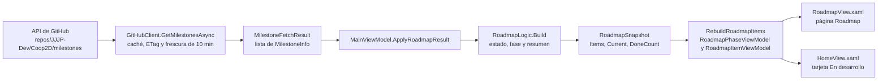
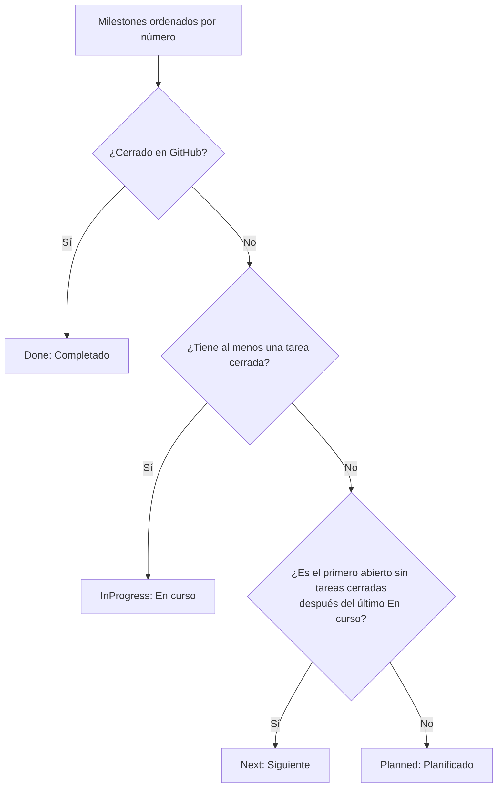

# Roadmap: cómo funciona y cómo mantenerlo

Guía para el desarrollador: de dónde salen los datos de la página **Roadmap** y de la tarjeta «En desarrollo» de
Inicio, qué reglas deciden el estado de cada hito, cómo escribir los milestones en GitHub para que se vean bien y dónde
tocar el código si quieres cambiar el comportamiento.

> Describe el launcher **1.0.4** (el roadmap existe desde la 1.0.3). Índice de toda la documentación:
> [docs/README.md](../README.md).

## Contenido

- [Qué ve el jugador](#qué-ve-el-jugador)
- [De GitHub a la pantalla](#de-github-a-la-pantalla)
- [Reglas de estado](#reglas-de-estado)
- [Fases según el título](#fases-según-el-título)
- [El resumen de cada hito](#el-resumen-de-cada-hito)
- [Progreso, fechas y descripción](#progreso-fechas-y-descripción)
- [Caché y cupo de GitHub](#caché-y-cupo-de-github)
- [Convenciones para los milestones en GitHub](#convenciones-para-los-milestones-en-github)
- [Tareas habituales en GitHub](#tareas-habituales-en-github)
- [Problemas típicos](#problemas-típicos)
- [Cambiar el comportamiento en el código](#cambiar-el-comportamiento-en-el-código)

## Qué ve el jugador

- **Página Roadmap** (icono de bandera en la barra izquierda, entre Versiones y Ajustes): cabecera «Roadmap de Coop2D»
  con «Comprobado a las HH:mm», botones **Actualizar** y **Ver en GitHub**; un resumen «3 de 14 hitos completados» con una
  barra segmentada (un trozo por hito); y la lista de hitos agrupada por fase (Pre-producción, Producción, Lanzamiento).
  Cada fila tiene icono de estado, título, una frase de resumen, la barra de progreso (solo en curso o completados) y se
  despliega para ver la descripción completa y el enlace **Ver en GitHub**.
- **Tarjeta «En desarrollo» en Inicio**: los hitos en curso (como mucho 2), con su barra y el enlace **Ver roadmap**. Si
  no hay ninguno en curso, muestra el siguiente. Se oculta si no hay datos.

**Por qué existe:** los amigos que prueban el juego ven hacia dónde va y qué se está probando ahora («¿es divertido
combinar elementos?»), sin tener que entrar en GitHub. Y para ti, mantenerlo cuesta cero: es lo mismo que ya usas para
organizar las tareas.

## De GitHub a la pantalla

Los datos son los **milestones** públicos del repo Coop2D. No hay ningún archivo de configuración: lo que escribas en
GitHub es lo que se ve.



| Paso | Archivo | Qué hace |
|---|---|---|
| 1. Descargar | [GitHubClient.cs](../../src/PalitoLauncher.Core/GitHub/GitHubClient.cs) | `GetMilestonesAsync` pide `GET /repos/{owner}/{repo}/milestones?state=all&per_page=100` y `ParseMilestones` convierte el JSON en `MilestoneInfo`, ordenados por número. Nunca lanza: si falla devuelve la caché (marcada como `OfflineCache`) o `null` |
| 2. Modelos | [MilestoneModels.cs](../../src/PalitoLauncher.Core/GitHub/MilestoneModels.cs) | `MilestoneInfo` (número, título, descripción, abierto/cerrado, tareas abiertas y cerradas, fechas, URL) y `MilestoneFetchResult` (lista + origen + aviso) |
| 3. Clasificar | [RoadmapLogic.cs](../../src/PalitoLauncher.Core/State/RoadmapLogic.cs) | `RoadmapLogic.Build` decide estado, fase y resumen de cada hito; `FormatProgress` hace el texto «14 de 25 tareas · 56 %». Lógica pura, sin E/S: por eso tiene muchos tests |
| 4. Orquestar | [MainViewModel.Roadmap.cs](../../src/PalitoLauncher/ViewModels/MainViewModel.Roadmap.cs) | Cuándo se consulta (`RefreshRoadmapAsync`, `RefreshRoadmapManuallyAsync`, `RefreshRoadmapIfStale`), respeto del cupo, estados de carga/error y textos de la cabecera |
| 5. Presentar | [RoadmapItemViewModel.cs](../../src/PalitoLauncher/ViewModels/RoadmapItemViewModel.cs) | `RoadmapItemViewModel` (una fila: textos, barra, fechas, expandir) y `RoadmapPhaseViewModel` (un grupo de fase) |
| 6. Dibujar | [RoadmapView.xaml](../../src/PalitoLauncher/Views/RoadmapView.xaml) y [HomeView.xaml](../../src/PalitoLauncher/Views/HomeView.xaml) | Plantillas XAML, colores e iconos |

**Por qué la clasificación está en el Core y no en el ViewModel:** así se puede probar con datos reales sin abrir
ninguna ventana. [RoadmapLogicTests.cs](../../tests/PalitoLauncher.Tests/RoadmapLogicTests.cs) usa una copia de los 14
milestones reales de Coop2D (en [GitHubMilestonesTests.cs](../../tests/PalitoLauncher.Tests/GitHubMilestonesTests.cs),
clase `Coop2DMilestonesJson`) y comprueba exactamente lo que se mostraría.

### Cuándo se consulta

| Momento | Método | ¿Gasta cupo de la API? |
|---|---|---|
| Al abrir el launcher (en segundo plano, tras las releases) | `RefreshRoadmapAsync(bypassFreshness: false, automatic: true)` desde `InitializeAsync` | Solo si la copia guardada tiene más de 10 min |
| Comprobación periódica (cada 60 min, si el launcher no está ocupado ni con el juego abierto) | `PeriodicCheckAsync` → `RefreshRoadmapAsync(..., automatic: true)` | Igual: como mucho 1 consulta cada 10 min |
| Al entrar en la página Roadmap | `RefreshRoadmapIfStale` | Solo si el último intento tiene más de 10 min (o si no hay datos y pasó más de 1 min) |
| Botón **Actualizar** (o **Reintentar**) | `RefreshRoadmapManuallyAsync` | Sí, 1 consulta (se salta la frescura), salvo que se acabe de comprobar hace menos de 60 s |

Las consultas automáticas se saltan si quedan **10 consultas o menos** a GitHub
(`LauncherConfig.RateLimitReserveForUser`), para guardarlas para lo importante (instalar y actualizar el juego). Única
excepción: si aún no hay nada que enseñar, se intenta **una vez por sesión** sin saltarse la frescura. Ningún fallo del
roadmap muestra diálogos: todo va al log.

## Reglas de estado

`RoadmapLogic.Build` ordena los milestones por **número** y clasifica cada uno:



| Estado (`MilestoneStatus`) | Regla | Cómo se ve |
|---|---|---|
| `Done` | El milestone está **cerrado** en GitHub (aunque le queden tareas abiertas) | ✓ verde, «Completado», barra llena |
| `InProgress` | Abierto y con **al menos una tarea cerrada** | Círculo ámbar, insignia «En curso», barra y «14 de 25 tareas · 56 %» |
| `Next` | El **primer** abierto sin tareas cerradas que va **después del último en curso** (si no hay ninguno en curso, el primer abierto) | Círculo azul con borde, insignia «Siguiente» |
| `Planned` | El resto de abiertos | Punto tenue |

- **Pueden estar varios en curso a la vez** (p. ej. Pre 1 y Pre 2), y la tarjeta de Inicio los muestra (como mucho 2).
  `RoadmapSnapshot.Current` = los en curso; si no hay ninguno, el siguiente; si todo está cerrado, ninguno.
- Un abierto sin tareas cerradas que está **antes** del último en curso queda como **Planificado**, no como Siguiente
  (el «siguiente» siempre mira hacia delante).

**Ejemplo con los datos reales de Coop2D** (los del test `Build_RealCoop2DMilestones`):

| # | Milestone | Tareas cerradas / totales | Estado |
|---|---|---|---|
| 1 | Pre 1 · Tech prototype | 26 / 27 | En curso |
| 2 | Pre 2 · Gameplay prototype | 14 / 25 | En curso |
| 3 | Pre 3 · First playable | 0 / 24 | Siguiente |
| 4 | Pre 4 · Vertical slice | 0 / 0 | Planificado |
| 5-14 | 0.1 · Runs and rooms … 1.0 · Launch | 0 / 0 | Planificado |

Si cierras el Pre 1 en GitHub, pasa a Completado y la tarjeta de Inicio muestra solo el Pre 2.

**Por qué estas reglas:** usan solo datos que GitHub ya tiene (abierto/cerrado y número de tareas), así que no hay que
mantener nada aparte. «En curso» se activa solo en cuanto cierras la primera tarea, y «Completado» es una decisión tuya
(cerrar el milestone), no un 100 % automático: puedes dar un hito por bueno aunque queden tareas que pasan al siguiente.

## Fases según el título

`RoadmapLogic.GetPhase` deduce la fase del **título** del milestone:

| Regla | Fase | Ejemplos (del test `Phase_IsDerivedFromTitle`) |
|---|---|---|
| Empieza por «Pre» seguido de algo que no sea una letra, o por «Preprod…»/«Pre-prod…» | **Pre-producción** | «Pre 1 · Tech prototype», «Pre2», «pre-alpha», «Preproducción», «Pre-production» |
| Empieza por una versión con número mayor ≥ 1 (opcionalmente con «v») | **Lanzamiento** | «1.0 · Launch», «1.1 · Post-launch», «v2.0 · DLC», «10.3» |
| Todo lo demás | **Producción** | «0.1 · Runs and rooms», «0.9 · Private beta · Localization», «Launch», «Presentación final», «Prestige system» |

Los grupos se muestran en el orden en que aparece su primer hito (que ya va ordenado por número).

**Por qué por el título:** GitHub no tiene un campo «fase» en los milestones, y el título ya sigue la convención del
proyecto (Pre N / 0.N / 1.0). Ojo con los casos raros: «Launch» a secas cae en Producción porque no empieza por número.

## El resumen de cada hito

La frase gris bajo cada título sale de la **descripción** del milestone (`RoadmapLogic.ExtractSummary`):

1. Busca la **primera** etiqueta `Pregunta:` u `Objetivo:` (sin distinguir mayúsculas; también en negrita, como
   `**Pregunta:**` o `**Objetivo**:`).
2. Toma el texto que sigue **hasta el final de esa línea** (si la etiqueta está sola en su línea, usa la línea
   siguiente).
3. Corta en el **primer punto que cierra frase** (un `.` seguido de espacio o del final). Los puntos de las versiones
   («0.1», «v1.2») no cortan.
4. Quita marcas de Markdown (`**`, `__`, `` ` ``), junta espacios, pone la **primera letra en mayúscula** (saltándose
   `¿`, `¡`, `«`) y recorta a **160 caracteres** con «…» (por palabra si puede).
5. Si no hay etiqueta, o queda vacía, no hay resumen (la fila muestra solo el título).

| Descripción | Resumen |
|---|---|
| `Pre-producción.` ⏎ `Pregunta: ¿pueden 2-4 jugadores conectarse por internet y moverse, con el host como autoridad?` ⏎ `Hecho cuando: …` | ¿Pueden 2-4 jugadores conectarse por internet y moverse, con el host como autoridad? |
| `Producción.` ⏎ `Objetivo: partidas formadas por salas con enemigos, cofres y una salida. Cada partida dura unos 20 minutos.` | Partidas formadas por salas con enemigos, cofres y una salida. |
| `` **Pregunta**: ¿se entiende `detonar` sin __tutorial__? `` | ¿Se entiende detonar sin tutorial? |
| `Objetivo: 4 jugadores... sin lag.` | 4 jugadores... (los tres puntos seguidos de espacio cortan la frase) |
| `Hecho cuando: 4 jugadores se mueven.` (sin etiqueta) | *(sin resumen)* |
| `Los objetivos: ninguno` | *(sin resumen: «objetivos» no es la etiqueta)* |

**Por qué así:** cada milestone de Coop2D ya responde a una pregunta (pre-producción) o persigue un objetivo
(producción); esa frase es lo que un jugador necesita para entender el hito de un vistazo, y el resto de la descripción
queda en la vista desplegada.

## Progreso, fechas y descripción

- **Progreso** (`RoadmapLogic.FormatProgress`): «14 de 25 tareas · 56 %» (redondeado **hacia abajo**: nunca muestra
  «100 %» si queda alguna abierta), «1 de 1 tarea · 100 %», «Sin tareas todavía» si no tiene ninguna, y «Completado» si
  está cerrado. Las tareas son lo que GitHub cuenta en el milestone (`open_issues` / `closed_issues`): issues y también
  pull requests asignadas a él. Una issue cerrada como «not planned» cuenta como cerrada.
- La barra y el texto de progreso solo se ven en hitos **en curso** o **completados** (`RoadmapItemViewModel.ShowProgress`).
- **Fechas** (`RoadmapItemViewModel.DatesText`): si está completado, «Completado el dd/MM/aaaa» (fecha de cierre); si no y
  tiene fecha límite en GitHub (*Due date*), «Fecha prevista: dd/MM/aaaa».
- **Descripción completa** (al desplegar la fila): se dibuja con `MarkdownRenderer`, el mismo que las notas de versión
  (títulos, listas, negrita, cursiva, código y enlaces; **sin tablas ni imágenes**). Se quita el pie automático del final
  («---» seguido de «_Generated by …_») con `RoadmapItemViewModel.CleanDescription`. Sin descripción: «Este hito aún no
  tiene descripción.».

## Caché y cupo de GitHub

Sin token, la API de GitHub permite **60 consultas por hora y por IP**, y las respuestas 304 «sin cambios» **también
cuentan** (ver [README](../../README.md#límites-de-la-api-de-github)). Por eso el roadmap:

- **Gasta como mucho 1 consulta cada 10 minutos** de forma automática (`LauncherConfig.MilestonesFreshnessWindow`):
  si la copia guardada tiene menos de 10 min, `GitHubClient` la devuelve sin preguntar.
- Guarda la respuesta en `%LOCALAPPDATA%\PalitoLauncher\cache\api-<16 caracteres>.json` (un archivo por URL, el mismo
  mecanismo que las releases) y pregunta con `If-None-Match` (ETag): si no cambió, GitHub responde 304 sin reenviar los
  datos.
- **Sin conexión** muestra la última copia guardada; la cabecera dice el motivo real («Sin conexión · datos guardados»,
  el límite de consultas…). Sin copia guardada: «No se pudo cargar el roadmap. Revisa tu conexión.» con **Reintentar**.
- Si quedan pocas consultas, el texto dice «GitHub limita las consultas y ahora quedan pocas: el roadmap se cargará más
  tarde. Pulsa Reintentar para cargarlo ya.».
- Con el cupo agotado, `GitHubClient` no pregunta hasta la hora de restablecimiento y devuelve la caché.

**Por qué 10 minutos:** el progreso de los milestones cambia despacio (unas pocas tareas al día), mientras que las
releases sí necesitan comprobarse a menudo. 10 min es el equilibrio entre «se ve actualizado» y «no le quita consultas a
instalar y actualizar el juego», sobre todo cuando varios amigos comparten la misma IP.

Un arranque normal del launcher gasta 2 consultas: releases y roadmap (este, solo si pasaron 10 min). Más 1, como
mucho cada 2 h, para buscar versión nueva del launcher.

## Convenciones para los milestones en GitHub

Para que el roadmap se vea bien, crea los milestones así (es lo que ya hace Coop2D):

**Orden = número.** GitHub numera los milestones en el orden en que los **creas** y el número no se puede cambiar. El
launcher los ordena por ese número, así que **créalos en el orden del roadmap**. Si necesitas meter un hito entre dos
existentes, la única forma es renombrar (cambiar título y descripción) los posteriores para «desplazarlos», o aceptar el
hito al final.

**Título**: corto, empezando por la fase o la versión, con ` · ` como separador:

| Fase | Formato | Ejemplos |
|---|---|---|
| Pre-producción | `Pre N · Nombre` | `Pre 2 · Gameplay prototype` |
| Producción | `0.N · Nombre` | `0.1 · Runs and rooms`, `0.5 · Beta · CBT 1` |
| Lanzamiento | `1.0 · Nombre` (o mayor) | `1.0 · Launch` |

**Descripción** (Markdown sencillo): primera línea con la fase, luego la etiqueta del resumen en su propia línea y un
criterio de terminado. Plantilla:

```markdown
Pre-producción.

Pregunta: ¿se entiende el bucle de juego sin que nadie lo explique?

Hecho cuando: 3 de 4 jugadores terminan una partida sin ayuda.
```

```markdown
Producción.

Objetivo: un segundo mapa con enemigos y jefe propios.

Hecho cuando: se puede jugar entero de principio a fin.
```

Consejos para la línea del resumen:

- Una sola frase. Lo que haya después del primer punto no sale en el resumen (sí en la descripción desplegada).
- Evita «...» (tres puntos seguidos de espacio cortan la frase) y abreviaturas con punto como «p. ej.» o «etc.» en
  mitad de la frase; usa «…» (un solo carácter) si lo necesitas.
- Si una descripción tiene `Objetivo:` y `Pregunta:`, gana la que aparece primero.
- Máximo útil: unos 150 caracteres. Más largo se corta con «…».

**Fecha límite** (*Due date*): opcional. Si la pones, sale «Fecha prevista: …». Pon fechas solo si las vas a mantener:
una fecha pasada en un hito abierto da mala impresión.

**Tareas**: asigna las issues (y PRs) al milestone desde la barra lateral de cada issue (**Milestone**). El porcentaje es
tareas cerradas / totales.

## Tareas habituales en GitHub

**Crear un milestone:** repo Coop2D → **Issues** → **Milestones** → **New milestone** → título, fecha (opcional),
descripción → **Create milestone**. Recuerda: el número lo pone GitHub en orden de creación.

**Marcar un hito como «en curso»:** cierra su primera tarea. Si empiezas a trabajar en él pero aún no has cerrado nada,
seguirá como Siguiente o Planificado; un truco es tener una tarea pequeña tipo «Planificar Pre 3» y cerrarla al empezar.

**Cerrar un milestone (marcarlo como completado):** **Issues → Milestones** → en la fila del milestone pulsa **Close**
(o ábrelo → **Edit milestone** → **Close milestone**). Antes, mueve al siguiente milestone las tareas abiertas que no
vayas a hacer, para que el porcentaje del siguiente sea realista. En el launcher pasará a «Completado» en la próxima
consulta (como mucho 10 min, o al momento con **Actualizar**). Se puede reabrir con **Reopen**.

**No borres milestones**: ciérralos. Al borrar uno desaparece del roadmap y sus tareas se quedan sin milestone.

**Ver el resultado sin esperar:** en el launcher, página Roadmap → **Actualizar** (gasta 1 consulta). Si dice
«Comprobado hace un momento.», espera un minuto.

## Problemas típicos

| Síntoma | Causa probable | Qué hacer |
|---|---|---|
| Un cambio en GitHub no se ve | Caché de 10 min | Pulsa **Actualizar** en la página Roadmap |
| «Sin conexión · datos guardados» u otro aviso en la cabecera | No se pudo consultar GitHub (sin internet, límite de consultas…) | Se muestra la última copia; se arregla solo cuando vuelva la conexión o el cupo |
| «No se pudo cargar el roadmap. Revisa tu conexión.» | Primer arranque sin internet (no hay copia guardada) | **Reintentar** cuando haya conexión |
| «GitHub limita las consultas…» | Quedan pocas consultas de las 60/h (se comparten por IP) | Esperar a la hora indicada; el juego se puede seguir instalando y jugando |
| Un hito sale en la fase equivocada | El título no empieza por «Pre» ni por una versión | Renombra el milestone según las [convenciones](#convenciones-para-los-milestones-en-github) |
| Un hito no tiene frase de resumen | Falta `Pregunta:` u `Objetivo:` en la descripción | Añade la etiqueta en su propia línea |
| El resumen sale cortado raro | Un punto en mitad de la frase («p. ej.», «...») | Reescribe la frase sin puntos intermedios |
| Los hitos salen en mal orden | El orden es el número de GitHub (orden de creación) | Renombra los milestones para que el número encaje |
| Un hito «terminado» sigue En curso | El milestone sigue abierto | Ciérralo en GitHub |
| «Este proyecto aún no tiene milestones en GitHub.» | GitHub respondió con una lista vacía: el repo no tiene ningún milestone | Crea los milestones |
| No carga nunca, ni con internet | El repo es privado o cambió de nombre (la API sin token no ve repos privados y responde 404) | El repo del juego debe ser público; revisa `LauncherConfig.GameRepoOwner` / `GameRepoName` |
| Falta algún hito con más de 100 | Solo se pide la primera página (`per_page=100`) | Improbable; habría que paginar en `GetMilestonesAsync` |

El informe para el desarrollador (**⋯ → Crear informe para el desarrollador**) incluye una línea con el estado del
roadmap («3/14 hitos (origen Network)»), útil si un amigo dice que no le carga.

## Cambiar el comportamiento en el código

| Quiero… | Dónde | Test que lo cubre |
|---|---|---|
| Cambiar cada cuánto se consulta como mucho | `LauncherConfig.MilestonesFreshnessWindow` en [LauncherConfig.cs](../../src/PalitoLauncher.Core/LauncherConfig.cs) | — |
| Cambiar la reserva de consultas | `LauncherConfig.RateLimitReserveForUser` (afecta también a las releases) | — |
| Usar los milestones de otro repo | `LauncherConfig.GameRepoOwner` / `GameRepoName` (también cambia las releases) y `GameMilestonesPageUrl` | — |
| Cambiar las reglas de estado | `RoadmapLogic.Build` en [RoadmapLogic.cs](../../src/PalitoLauncher.Core/State/RoadmapLogic.cs) | `RoadmapLogicTests.Build_*` |
| Añadir o cambiar una fase | `RoadmapLogic.GetPhase`, las regex `PreProductionTitle` y `VersionTitle` y las constantes `PhasePreProduction`, `PhaseProduction`, `PhaseLaunch` | `RoadmapLogicTests.Phase_IsDerivedFromTitle` |
| Aceptar otra etiqueta para el resumen (p. ej. «Meta:») | La regex `SummaryLabel` en `RoadmapLogic` | `RoadmapLogicTests.Summary_*` |
| Cambiar la longitud del resumen | `RoadmapLogic.MaxSummaryLength` | `Summary_LongText_IsCutAtWordWithEllipsis` |
| Cambiar el texto de progreso | `RoadmapLogic.FormatProgress` | `RoadmapLogicTests.FormatProgress_Texts` |
| Mostrar más hitos en Inicio | `MaxHomeRoadmapItems` en [MainViewModel.Roadmap.cs](../../src/PalitoLauncher/ViewModels/MainViewModel.Roadmap.cs) | — |
| Cambiar los textos de estado («En curso»…) | `RoadmapItemViewModel.StatusText` y las insignias en [RoadmapView.xaml](../../src/PalitoLauncher/Views/RoadmapView.xaml) | `BindingSmokeTests` (bindings) |
| Cambiar los mensajes de error/carga | Constantes `RoadmapFailedMessage` y `RoadmapDeferredMessage` en `MainViewModel.Roadmap.cs` | — |
| Cambiar colores o iconos | [RoadmapView.xaml](../../src/PalitoLauncher/Views/RoadmapView.xaml) (usa los pinceles del tema, p. ej. `AccentBrush`, `InfoBrush`) | `BindingSmokeTests` |
| Leer más de 100 milestones | La URL de `GitHubClient.GetMilestonesAsync` (habría que pedir varias páginas) | `GitHubMilestonesTests` |

Ejemplo: así decide `RoadmapLogic.Build` el estado básico de cada hito (antes de buscar el «Siguiente»):

```csharp
statuses[i] = m.IsClosed ? MilestoneStatus.Done
    : m.ClosedIssues > 0 ? MilestoneStatus.InProgress
    : MilestoneStatus.Planned;
```

Después de cambiar algo, ejecuta los tests del roadmap:

```powershell
dotnet test PalitoLauncher.sln --filter "FullyQualifiedName~RoadmapLogicTests|FullyQualifiedName~GitHubMilestonesTests"
```

Y si cambias la regla de estado o de fase, actualiza las tablas de este documento y la sección «Roadmap» del
[README](../../README.md#roadmap-1).
